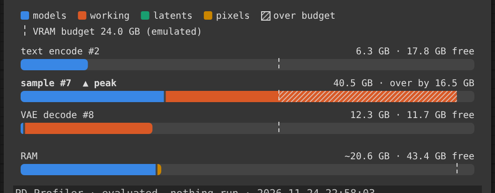

# PD Profiler: how it works

For using the node, see [PD Profiler in the README](../README.md#pd-profiler). This note covers where each number comes from, which ComfyUI internals the node relies on, the sidecar, and using it without the browser.



*Wan 2.1 14B (fp8) at 1280×720, 81 frames, budgeted against a 24 GB card. Sampling runs 16.5 GB over, mostly in working memory, so resolution or frame count is the thing to cut, not the model.*

## Code

| File | What it holds |
|------|---------------|
| `core/profiler.py` | The upstream walk, latent shapes, stages, memory formulas, time estimate, the text report (`format_report`), the chart data (`build_chart`) and the sidecar path (`profile_path`). No torch or ComfyUI imports: ComfyUI is reached through a `ComfyEnv`. |
| `core/model_files.py` | safetensors and GGUF header reading (cached by path, size and mtime), diffusion model detection, the VAE families and their decode formulas, text encoder sizes. |
| `core/capture.py` | Measurements during runs (node times, VRAM peaks), the machine's GPU, VRAM and RAM, the models ComfyUI holds. |
| `nodes/profiler.py` | The node, the `ComfyEnv` for the running ComfyUI, and the two routes. |
| `web/pd_profiler.js`, `web/pd_profiler_chart.js` | Buttons, the report panel and the chart. |
| `tests/test_profiler.py` | Standard-library tests with header-only sparse model files. |

## Where each number comes from

**The walk.** The frontend sends the API prompt (`app.graphToPrompt()`), the graph as it will run: subgraphs flattened, bypassed nodes passed through, muted nodes left out. From the profiler's `source`, every link is followed upstream. At a PD Wedge only the selected row's `input_N` is followed: the queued row (`pd_wedge_row`), else `solo`, else row 1. A wildcard output (PD Wedge, PD Switch) takes the type of the input it passes on.

**Roles come from socket types, not node names**, so custom node packs are covered when they use ComfyUI's types:

| Role | Rule |
|------|------|
| sampler | returns LATENT, reads a LATENT and a MODEL or GUIDER |
| VAE decode | reads a VAE and a LATENT, returns IMAGE (tiled if the class name says so) |
| text encoder | reads CLIP, returns CONDITIONING |
| loader | the end of a MODEL / VAE / CLIP / CLIP_VISION chain, read through its file inputs (`unet_name`, `ckpt_name`, `clip_name*`, `vae_name`, `lora_name`) |
| latent source | the end of a LATENT chain |
| API node | the class's `API_NODE` flag, or a class from `comfy_api_nodes` |

**Model files.** Only the header is read: the safetensors JSON table, or the GGUF tensor table (dims reversed to torch order; ComfyUI-GGUF's `comfy.gguf.orig_shape.*` keys restore reshaped tensors). Shape-only stand-ins go through ComfyUI's own `comfy.model_detection.unet_prefix_from_state_dict` and `model_config_from_unet`, which give the model's config class (`WAN21_T2V`, `WAN22_T2V`, ...), latent format, `memory_usage_factor` and inference data types. A few model types read real weight values during detection; for those, and outside ComfyUI, a file-name table is used and the report says "guessed from file name". Checkpoints are split by key prefix (`model.diffusion_model.`, `first_stage_model.`, `cond_stage_model.` / `conditioner.` / `text_encoders.`).

**Bytes in memory.** GGUF and fp8 weights stay as stored. fp32 weights are cast to the inference type. A loader's `weight_dtype` fp8 setting stores every weight with two or more dimensions in 1 byte. Inference and VAE data types come from `comfy.model_management` (`unet_dtype`, `vae_dtype`, `text_encoder_dtype`).

**Latent shape.** `[batch, channels, (length - 1) // temporal + 1, height // spatial, width // spatial]`, with ComfyUI's floor division. Channels come from the model when ComfyUI identified it, else from the VAE. Spatial and temporal compression come from the VAE family. Widgets fed by a constant node or a PD Wedge's `text` / `int` / `float` are resolved; anything computed at run time is reported as "only known at run time". `LatentUpscale`, `LatentUpscaleBy` and `RepeatLatentBatch` along the chain are applied.

**Sampling memory** is `BaseModel.memory_required` for a batch of two (what `comfy/sampler_helpers.estimate_memory` loads models against): `batch × prod(spatial dims) × dtype size × 0.01 × memory_usage_factor` MiB with xformers or flash attention, `× 0.15 × memory_usage_factor` MiB otherwise. ComfyUI marks this formula as needing tuning: expect it to read high.

**VAE decode memory** is the family's `memory_used_decode` from `comfy/sd.py` (Wan 2.1, Wan 2.2, LTX-Video, LTX 2.4, HunyuanVideo, HunyuanVideo 1.5, CogVideoX, Hunyuan image VAEs, KL/SD/SDXL/Flux, Flux 2, Qwen-Image 2.1) for one sample, or for one tile with tiled decode (`tile_size`, `temporal_size`).

**Stages and verdicts.** Text encode is the weights. Each sampler is weights + sampling + latent. Each decode is weights + decode memory. The budget available is the VRAM budget minus `comfy.model_management.minimum_inference_memory()` (0.8 GB plus `--reserve-vram`):

- fits;
- offloads N (weights + working memory over what's available, so ComfyUI loads part of the model);
- over budget (working memory alone is over: ComfyUI offloads every weight and may still run out);
- falls back to tiled decode (ComfyUI retries a decode that doesn't fit as tiled).

**RAM** is all model weights in the branch plus the decoded frames (`width × height × 3 × 4` bytes per frame, float32).

**No GPU.** On a machine without one, the GPU formulas and 16-bit data types are used, since the numbers are only useful for a machine that has a GPU. Set `vram_gb` to budget against a card.

## Time

Measured node times come back with each run. The frontend merges them into the node's `properties.pd_profile_timings`, so they're saved with the workflow, and sends them with each **profile**. Samplers are scaled by steps (effective steps for `KSamplerAdvanced`; the scheduler's for custom samplers) and linearly by latent tokens. Linear scaling is rough when the size changes, and the report says when it scaled.

With wedges, a node runs every job when it is downstream of a wedge or on a row's branch; everything else runs once per queue. The total is `once + jobs × per job`. Nodes not measured yet (new, or cached in the measured run) are counted and left out.

## Measured runs

ComfyUI creates a `comfy_execution.progress.ProgressRegistry` for each prompt and calls its handlers' `start_handler` / `finish_handler` around every node. `core/capture.py` wraps the registry's constructor to register a read-only handler on each new registry. It records:

- wall-clock seconds per node, or "cached";
- the prompt's VRAM peak (`torch.cuda.max_memory_allocated`, reset when the registry is created at prompt start);
- with `vram_per_node` on any profiler in the prompt: each node's peak, by resetting the peak counter at each node start.

Nothing ComfyUI does or sends changes. On a ComfyUI without the registry, runs carry no measurements and the report says so. The last 8 runs are kept.

The profiler is an output node with `IS_CHANGED` returning NaN, so it runs every queue. Its `source` input is lazy: with `enabled` off the input isn't requested, so a branch that only feeds the profiler doesn't run.

## Sidecar

With `export_sidecar` on, each run writes JSON:

- `path` is a file → `<folder>/<stem>.profile.json`. For an image format, a trailing frame number is dropped (`.1001`, or the `sequence.frame_separator` setting), matching PD Output's own sidecar. For PD Output's `path_all`, the first line is used.
- `path` is a folder → `<folder>/profile_<YYYYmmdd_HHMMSS>.json`.
- empty → `output/pipedream_profiles/profile_<YYYYmmdd_HHMMSS>.json`.

```json
{
  "node": "PDProfiler",
  "prompt_id": "...",
  "written": "2026-11-24 21:33:39",
  "settings": "settings: facility (none), user (none)",
  "profile": { "budget": {}, "models": [], "latents": [], "stages": [], "peak": {}, "ram": {},
               "wedge": {}, "time": {}, "api_nodes": [], "warnings": [], "notes": [] },
  "measured": { "nodes": [{"node", "label", "seconds", "cached", "vram_peak"}],
                "vram_peak": 0, "vram_reserved": 0, "loaded_models": [], "source": "...", "job": "2 of 3" },
  "timings": { "<node id>": {"seconds", "class", "steps", "tokens", "at"} }
}
```

Byte values are plain numbers in bytes.

## EXR metadata output

The node's one output is the profile as EXR metadata (`profile_metadata` in `core/profiler.py`), every name under `<exr.metadata_prefix>profiler/`:

| Name | Type | |
|------|------|-|
| `profiled_at`, `prompt_id`, `gpu` | string | |
| `vram_budget_gb`, `ram_budget_gb` | float | the budget used |
| `emulated` | int | 1 when `vram_gb` / `ram_gb` emulate another machine |
| `peak_vram_estimate_gb`, `peak_stage` | float, string | the largest stage |
| `stage_<n>` | string | e.g. `sample #7 KSampler: 25.10 GB (models 13.30 GB, working 11.80 GB, latents 0.008 GB), offloads` |
| `latent`, `latent_size`, `latent_frames` | string, string, int | `[1, 16, 21, 60, 104]`, `832x480`, `81` |
| `model_<n>`, `lora_<n>` | string | role and full file path |
| `api_nodes` | string | when any are upstream |
| `time_estimate_s`, `jobs` | float, int | when node times are known |
| `time_upstream_s`, `measured_peak_vram_gb`, `wedge_job` | float, float, string | what this run measured |

With `enabled` off the output is empty metadata. To feed PD Output, branch the profiler off before PD Output: a profiler after PD Output reading back into it would be a loop.

## Without the browser

`POST /pipedream/profiler/evaluate` with `{"prompt": <API prompt>, "node_id": "<profiler id>", "timings": {...}}` returns `{"text", "report", "chart"}` (`timings` is optional). The budget comes from the profiler's `vram_gb` / `ram_gb` in the prompt. A prompt without a PD Profiler can still be profiled by adding one:

```python
prompt["profiler"] = {"class_type": "PDProfiler", "inputs": {"source": ["<node id>", 0], "vram_gb": 16.0}}
report = post("/pipedream/profiler/evaluate", {"prompt": prompt, "node_id": "profiler"})
```

`GET /pipedream/profiler/machine` returns `{"gpu", "vram", "ram"}` in bytes.

Queued through `/prompt` (scripts, Deadline), the profiler runs like any output node: with `export_sidecar` on, each render leaves a `.profile.json` beside its output, a per-shot record of time and memory.

## Limits

- Memory figures are ComfyUI's own estimates, not measurements; compare them with a measured run's peak on your hardware.
- Text encoder activations, LoRA patch memory and custom samplers that manage their own memory (WanVideoWrapper, for example) aren't modelled. A sampler built on other socket types isn't recognised as a stage.
- Latent sizes computed at run time (from a loaded image's size or a maths node) aren't known before a run.
- Time scales linearly with steps and tokens.
