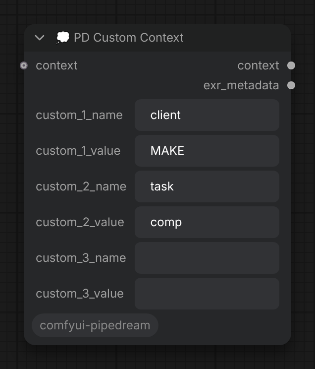
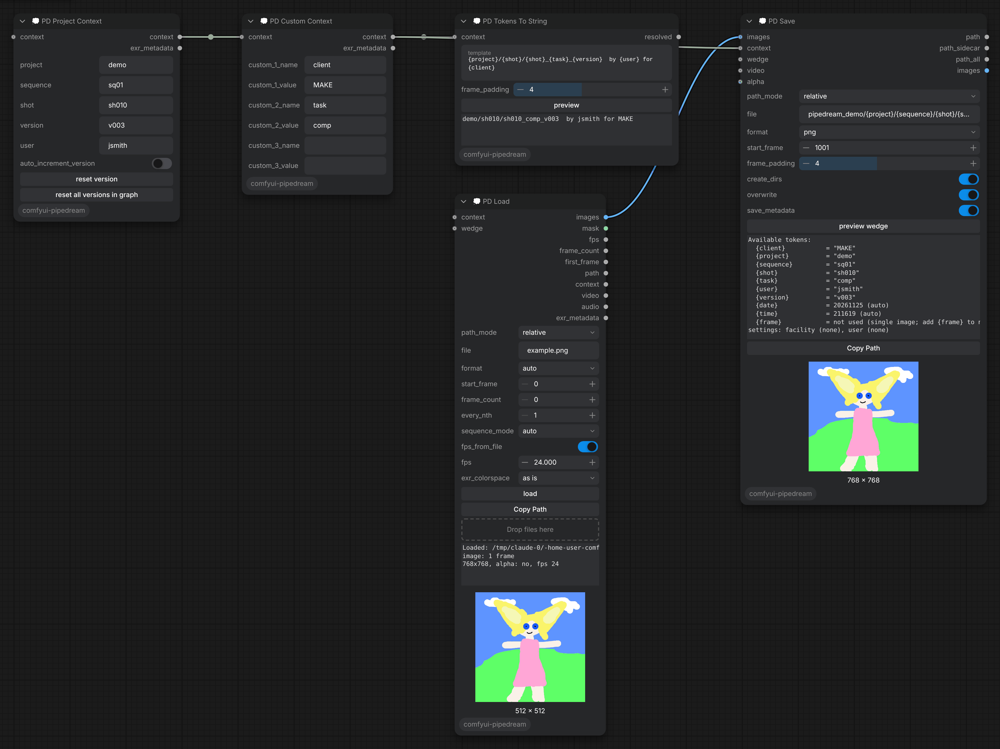

# PD Custom Context

Adds your own key/value tokens (`{task}`, `{department}`, `{client}`...) on top of a context. Use it for any detail PD Project Context does not have, and to add your own keys to EXR headers.

## Typical use
1. Connect a PD Project Context's `context` (optional).
2. Type a name in `custom_1_name` and its value in `custom_1_value`. A new pair appears once you name one.
3. Connect `context` onward to PD Save, PD Load or PD Tokens To String, and use `{task}` and so on in the template.
4. Connect `exr_metadata` to PD Save to write the pairs into EXR headers.

[01 Tokens](https://github.com/theonlyaaron/comfyui-pipedream/tree/main/workflows/01_tokens) adds `task` and `client`. [02 Load and save](https://github.com/theonlyaaron/comfyui-pipedream/tree/main/workflows/02_load_and_save) writes `client` into the EXR header.

## How it works
- **Pairs:** up to 10 name/value pairs. The node starts with one; the next appears as each name is filled in. Pairs in the middle stay visible so nothing jumps.
- **Skipped pairs:** a pair with an empty name is ignored; a missing value becomes an empty string.
- **Chaining:** the incoming `context` is copied and the pairs are merged in, so a pair overrides an incoming token of the same name.
- **EXR metadata:** `exr_metadata` outputs every token of the context (including incoming ones) as `pipedream/<name>` string attributes. Empty values are left out. Custom pairs are how you set your own keys. See [EXR metadata](https://github.com/theonlyaaron/comfyui-pipedream/blob/main/docs/exr-metadata.md).
- Names and values can also be linked from other nodes.

## Tips
- Unknown tokens stay as `{name}` in text, so a typo in a name shows up in the path or in PD Tokens To String's preview.
- Use short, lower-case names without spaces: they become attribute names too.

## See also
- [PD Project Context](https://github.com/theonlyaaron/comfyui-pipedream/blob/main/web/docs/PDProjectContext.md), [PD Tokens To String](https://github.com/theonlyaaron/comfyui-pipedream/blob/main/web/docs/PDTokensToString.md), [PD Save](https://github.com/theonlyaaron/comfyui-pipedream/blob/main/web/docs/PDSave.md), [PD EXR Metadata Merge](https://github.com/theonlyaaron/comfyui-pipedream/blob/main/web/docs/PDExrMetadataMerge.md)
- [Tokens](https://github.com/theonlyaaron/comfyui-pipedream/blob/main/docs/tokens.md), [EXR metadata](https://github.com/theonlyaaron/comfyui-pipedream/blob/main/docs/exr-metadata.md)

## Inputs and outputs
<!-- reference:start -->
<!-- reference:end -->
