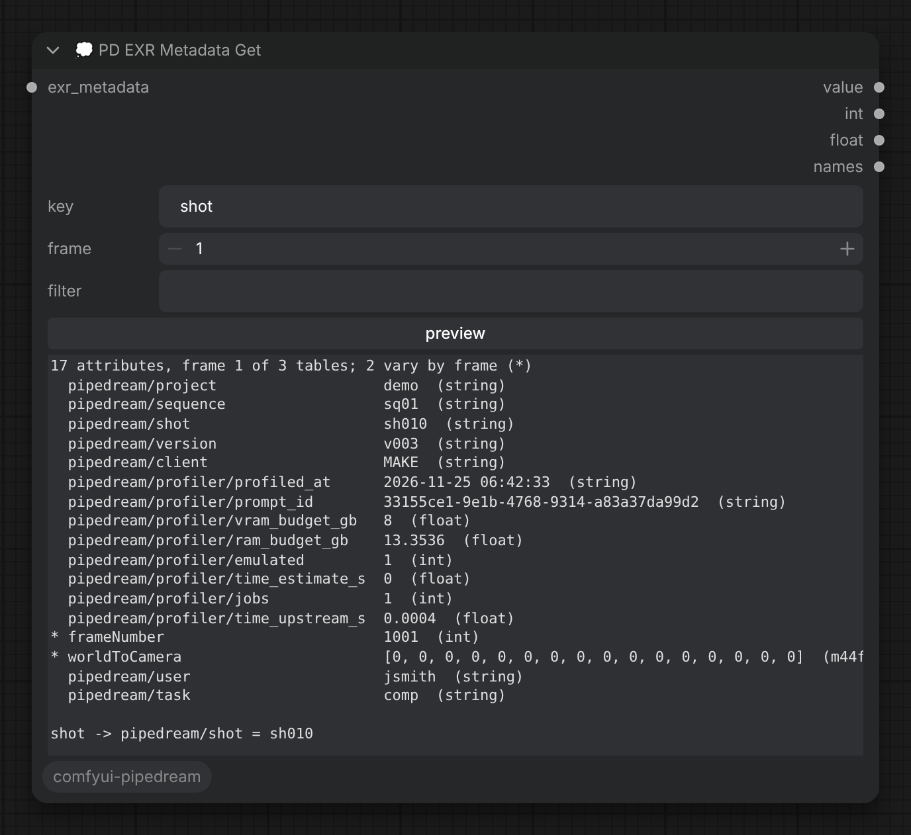
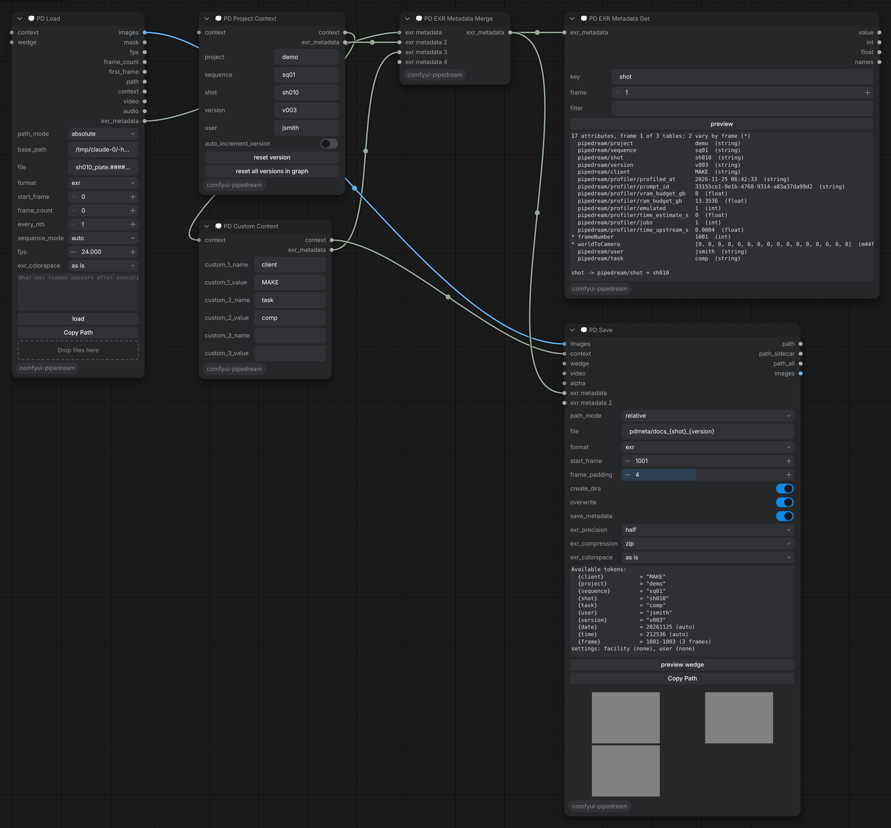

# PD EXR Metadata Get

Lists an EXR metadata stream on the node and outputs one attribute's value. Use it to check what a plate carries (camera matrices, timecode, a renderer's keys), or to feed one attribute into the graph.

## Typical use
1. Connect PD Load's `exr_metadata` (or a context node's, or PD Profiler's) to `exr_metadata`.
2. Press **preview**. It runs just this node and its inputs and lists every attribute in the panel.
3. Type a `key` such as `shot`. The `value`, `int` and `float` outputs carry that attribute.

[02 Load and save](https://github.com/theonlyaaron/comfyui-pipedream/tree/main/workflows/02_load_and_save) reads the metadata of a written sequence back and outputs `shot`.

## How it works

### The listing
- One attribute per line, with its type. Attributes that vary by frame are marked `*`.
- `frame` picks which frame's metadata to show (1 is the first loaded frame). A source with one table gives it for every frame.
- `filter` narrows the list to names containing the text (`camera`, `pipedream/profiler`). It affects the listing only, not the outputs.

### Picking a value
- `key` takes a full name (`pipedream/shot`, `worldToCamera`) or a unique last part (`shot`). A name that matches more than one attribute, or none, reports "not found (or matches more than one name)" in the panel and outputs empty values.
- `value` is the attribute as text: vectors in brackets, timecodes as `HH:MM:SS:FF`.
- `int` and `float` are the numeric value, or 0 when it is not a number.
- `names` is every attribute name of the chosen frame, one per line.

### Types
- Attributes keep their EXR types (string, int, float, double, vectors, matrices, box, chromaticities, timecode, rational, keycode, string and float vectors). Other types are carried as raw bytes.
- See [EXR metadata](https://github.com/theonlyaaron/comfyui-pipedream/blob/main/docs/exr-metadata.md) for how the stream works.

## Tips
- Use `filter` first to find the name, then set `key`.
- Nuke shows PD Save's attributes as `exr/pipedream/...`.
- The profiler's output works too: filter by `pipedream/profiler` to read its stages.

## See also
- [PD Load](https://github.com/theonlyaaron/comfyui-pipedream/blob/main/web/docs/PDLoad.md), [PD EXR Metadata Merge](https://github.com/theonlyaaron/comfyui-pipedream/blob/main/web/docs/PDExrMetadataMerge.md), [PD Save](https://github.com/theonlyaaron/comfyui-pipedream/blob/main/web/docs/PDSave.md), [PD Profiler](https://github.com/theonlyaaron/comfyui-pipedream/blob/main/web/docs/PDProfiler.md)
- [EXR metadata](https://github.com/theonlyaaron/comfyui-pipedream/blob/main/docs/exr-metadata.md)

## Inputs and outputs
<!-- reference:start -->
<!-- reference:end -->
