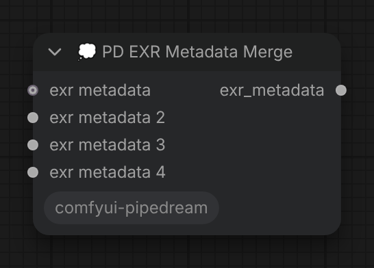
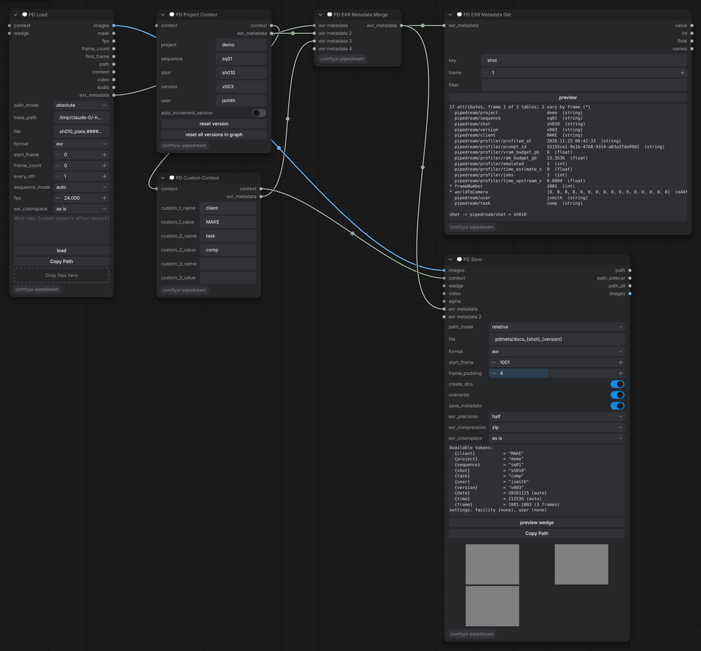

# PD EXR Metadata Merge

Combines up to 8 EXR metadata streams into one, frame by frame, later inputs winning. Use it to assemble a stream once (project tokens, your own keys, a plate's header) and send it to several PD Save nodes, or inspect it with PD EXR Metadata Get.

## Typical use
1. Connect a PD Project Context's `exr_metadata` to the first input.
2. Connect a PD Custom Context's `exr_metadata` (your own keys) or a PD Load's `exr_metadata` to the next. A spare input appears as you connect each.
3. Send `exr_metadata` to PD Save's `exr metadata` input, and optionally to PD EXR Metadata Get.

[02 Load and save](https://github.com/theonlyaaron/comfyui-pipedream/tree/main/workflows/02_load_and_save) merges a project context with a custom context (`client`) and writes the result into every frame.

## How it works
- **Inputs:** up to 8 streams, from PD Load, a context node, PD Profiler or another merge. A spare input appears after the highest connected one.
- **Order matters:** later inputs win on the same attribute name.
- **Per frame:** a source with one table per frame keeps its tables per frame (frame N's table goes into frame N). A single table applies to every frame.
- **Same rule as PD Save:** PD Save merges its own `exr metadata` inputs with exactly this rule, so a Merge is only needed to share or inspect the result.
- The output is a stream, not a file. Nothing is written until it reaches PD Save.

## Tips
- Put the broadest source (a plate's own header) first and your pipeline keys after, so yours win.
- Per-frame tables from a loaded sequence stay per frame, so camera data is not flattened.
- If PD Save writes no metadata, check that something is connected: with no input, only FFmpeg's defaults are written.

## See also
- [PD EXR Metadata Get](https://github.com/theonlyaaron/comfyui-pipedream/blob/main/web/docs/PDExrMetadataGet.md), [PD Save](https://github.com/theonlyaaron/comfyui-pipedream/blob/main/web/docs/PDSave.md), [PD Load](https://github.com/theonlyaaron/comfyui-pipedream/blob/main/web/docs/PDLoad.md)
- [PD Project Context](https://github.com/theonlyaaron/comfyui-pipedream/blob/main/web/docs/PDProjectContext.md), [PD Custom Context](https://github.com/theonlyaaron/comfyui-pipedream/blob/main/web/docs/PDCustomContext.md), [PD Profiler](https://github.com/theonlyaaron/comfyui-pipedream/blob/main/web/docs/PDProfiler.md)
- [EXR metadata](https://github.com/theonlyaaron/comfyui-pipedream/blob/main/docs/exr-metadata.md)

## Inputs and outputs
<!-- reference:start -->
<!-- Generated by tools/node_docs.py. Edit the node definition, not this block. -->

### Inputs

| Name | Type | Default | Required | Description |
|------|------|---------|----------|-------------|
| `exr_metadata, exr_metadata_2 … _8` | EXR_METADATA |  | optional | A metadata stream (PD Load, a context node, PD Profiler or another merge). Later inputs win on the same name. |

### Outputs

| Name | Type | Description |
|------|------|-------------|
| `exr_metadata` | EXR_METADATA | The inputs merged frame by frame: a source with one table per frame keeps them per frame, a single table applies to every frame, and later inputs win on the same name. |

This is not an output node: it runs only when another node needs its result.
<!-- reference:end -->
