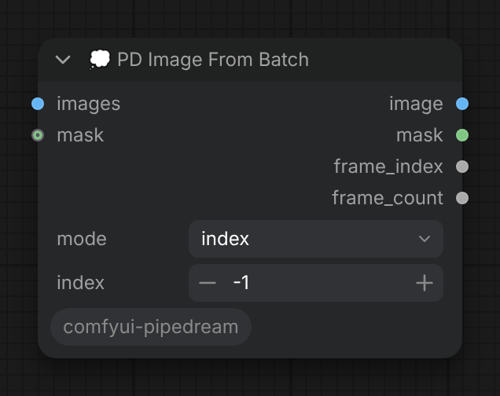
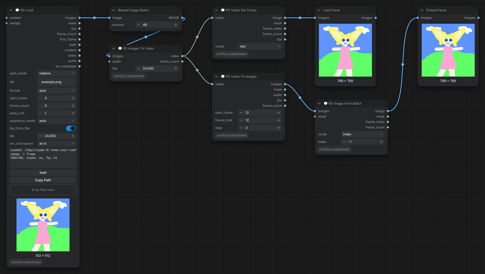

# PD Image From Batch

Picks one image from a batch (first, last, or by index) with its mask. Use it to pull a single frame out of a sequence or generated batch.

## Typical use
1. Connect `images` (and `mask` if you have one).
2. Set `mode` to `first`, `last` or `index`; for `index`, set `index`.
3. Use `image` and `mask`.

[03 Video frames](https://github.com/theonlyaaron/comfyui-pipedream/tree/main/workflows/03_video_frames) picks the last image of a batch with `-1`.

## How it works
- Negative `index` counts from the end (-1 is the last). `index` is shown only when `mode` is `index`.
- `frame_index` is the index used; `frame_count` is the batch size.
- `mask` picks the same frame. A one-frame mask is used for every image; otherwise it needs one frame per image, or the node stops with an error.
- With no mask: the fourth channel of RGBA images, else full opacity. 1.0 = opaque.

## Tips
- Core Load Image's mask is inverted; use Invert Mask first. See [Alpha](https://github.com/theonlyaaron/comfyui-pipedream/blob/main/docs/alpha.md).

## See also
- [PD Video Get Frame](https://github.com/theonlyaaron/comfyui-pipedream/blob/main/web/docs/PDVideoGetFrame.md), [PD Video To Images](https://github.com/theonlyaaron/comfyui-pipedream/blob/main/web/docs/PDVideoToImages.md), [PD Switch](https://github.com/theonlyaaron/comfyui-pipedream/blob/main/web/docs/PDSwitch.md)
- [Alpha](https://github.com/theonlyaaron/comfyui-pipedream/blob/main/docs/alpha.md)

## Inputs and outputs
<!-- reference:start -->
<!-- reference:end -->
