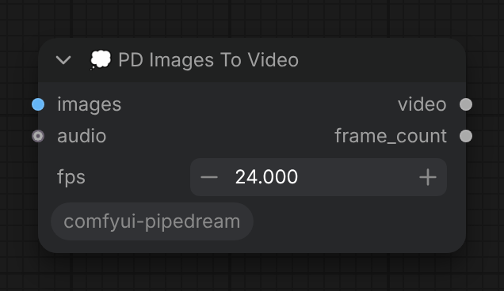
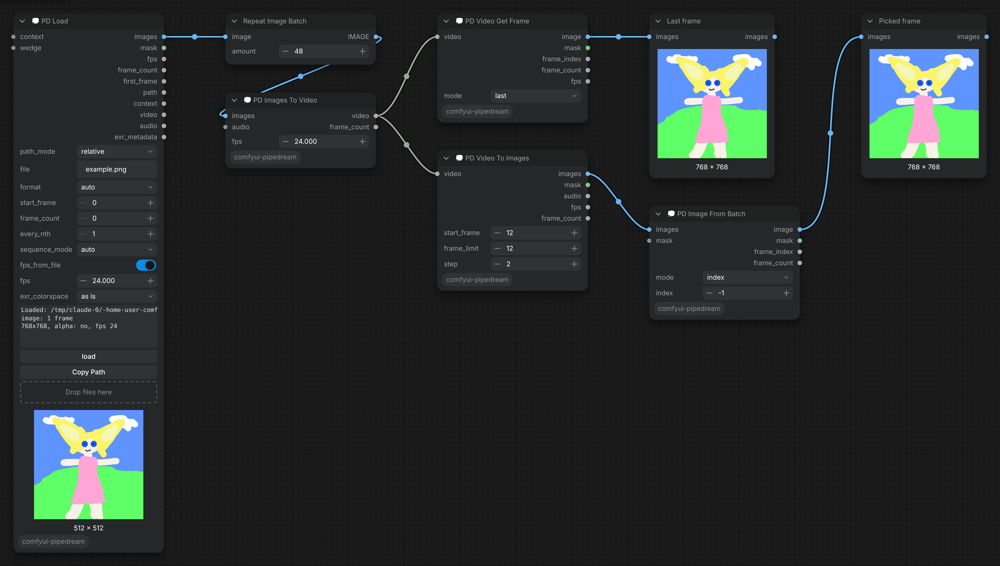

# PD Images To Video

Wraps an image batch, and optional audio, as an in-memory `VIDEO`. Use it to hand frames to a node that wants a video, such as PD Save's mp4/mov/webm output.

## Typical use
1. Connect `images` (and `audio` if you have it) and set `fps`.
2. Connect `video` to PD Save's `video` input and choose a video `format`.

[03 Video frames](https://github.com/theonlyaaron/comfyui-pipedream/tree/main/workflows/03_video_frames) wraps 48 frames at 24 fps and writes `clip_review.mp4`.

## How it works
- Nothing is encoded or written. Writing happens in a save node.
- It uses ComfyUI's core `VIDEO` type, so it works with Save Video and other packs.
- `fps` accepts NTSC rates such as 23.976, which snap to 24000/1001.
- The in-memory video has no separate alpha input; a fourth image channel stays in the frames.
- `frame_count` outputs the number of images.

## Tips
- With an image format, PD Save turns a connected `video` back into a numbered sequence.
- The default `fps` comes from the `output.fps` setting.

## See also
- [PD Save](https://github.com/theonlyaaron/comfyui-pipedream/blob/main/web/docs/PDSave.md), [PD Video To Images](https://github.com/theonlyaaron/comfyui-pipedream/blob/main/web/docs/PDVideoToImages.md), [PD Video Get Frame](https://github.com/theonlyaaron/comfyui-pipedream/blob/main/web/docs/PDVideoGetFrame.md), [PD Load](https://github.com/theonlyaaron/comfyui-pipedream/blob/main/web/docs/PDLoad.md)

## Inputs and outputs
<!-- reference:start -->
<!-- Generated by tools/node_docs.py. Edit the node definition, not this block. -->

### Inputs

| Name | Type | Default | Required | Description |
|------|------|---------|----------|-------------|
| `images` | IMAGE |  | required |  |
| `fps` | FLOAT | `24.0` | required | Frame rate. NTSC rates like 23.976 snap to 24000/1001. |
| `audio` | AUDIO |  | optional |  |

### Outputs

| Name | Type | Description |
|------|------|-------------|
| `video` | VIDEO |  |
| `frame_count` | INT |  |

This is not an output node: it runs only when another node needs its result.
<!-- reference:end -->
