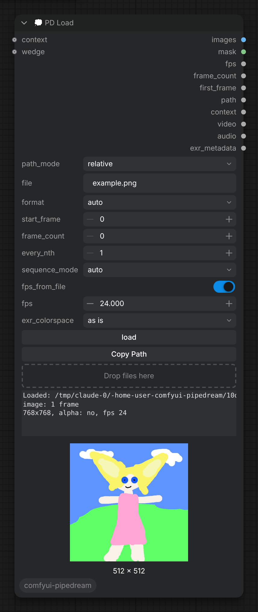
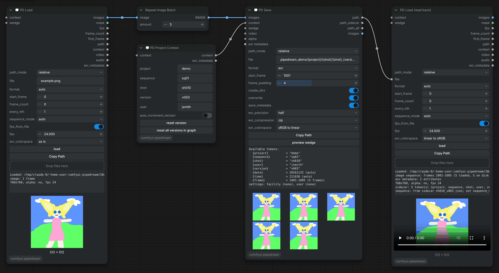

# PD Load

Loads an image, an image sequence or a video from any local or network path, and reads back what PD Save wrote: its tokens, its sequence and its EXR metadata. Use it for plates and renders that live outside ComfyUI's input folder.

## Typical use
1. Paste a file's full path into `file` (Explorer: shift+right click, *Copy as path*), or drop files on the node's drop zone.
2. Check the panel and preview after it loads. **load** runs just this node.
3. Connect `images` (and `mask`) downstream. To read a PD Save output back, link PD Save's `path` into `file`.

[02 Load and save](https://github.com/theonlyaaron/comfyui-pipedream/tree/main/workflows/02_load_and_save) loads a file, writes a sequence and reads it back with `sequence_mode`. [03 Video frames](https://github.com/theonlyaaron/comfyui-pipedream/tree/main/workflows/03_video_frames) reads an mp4 back as a clip.

<!-- media: clip, 10 s: dropping a sequence on PD Load's drop zone -->

## How it works

### Getting a file in
- **Paste a path** into `file` or `base_path`. Quotes are removed, the path is split into folder and name, `path_mode` switches to `absolute` and the file loads. Network files load in place.
- **Drop files** from Explorer onto the drop zone (anywhere on the node in the classic canvas). Browsers do not reveal a dropped file's path, so the files are copied to ComfyUI's `input/pipedream` folder (overwriting same-named files) and loaded from there in `relative` mode. Drop every frame of a sequence, plus its sidecar for the tokens. For files on a share, paste the path instead.
- **Copy Path** copies the full path of the file the widgets point at, resolved from `path_mode`, `base_path` and `file`, for Explorer, Finder or Nuke.
- **load** (or the selection toolbar's run button) runs just this node.

### Where and what
- `relative` reads from ComfyUI's input folder; `absolute` from `base_path`. A full path in `file` (such as PD Save's `path`) is used as is and ignores `base_path`.
- `file` may include the extension or leave it to `format`. `auto` tries every type and stops if more than one matches.
- Images: exr, png, jpg, webp, tif, dpx, bmp. Video: mp4, mov, webm, mkv, avi, m4v.

### Sequences
- Mark the frame with `####`, `%04d` or `{frame}`. PD Save's `name.1001.png` is found without a mark.
- `start_frame` (a frame number; 0 means the first on disk), `frame_count` (0 means all) and `every_nth` pick frames. Gaps are skipped and listed. `fps` is divided by `every_nth`.
- `sequence_mode` decides what a single numbered file loads (`shot.1002.exr` with `shot.1001.exr` beside it):
  - **auto** (default) loads the whole sequence unless it finds evidence of a single image: PD Save's sidecar (a single image's own `name.json` has no `sequence`; a sequence's names its pattern), frames of different sizes, or unpadded numbers of different lengths (`seed_1` ... `seed_10`, typical of wedges). Otherwise it guesses a sequence. The panel says what it decided and why.
  - **single file** loads just that file.
  - **sequence** loads every file named like it.
- A frame mark always loads a sequence.
- Workflows saved with the old `sequence_from_file` switch convert on load (on to auto, off to single file).

### Video
- `start_frame` is a frame index. `fps_from_file` (on) uses the video's rate; off, `fps` overrides it. Images always use `fps`.
- `video` is the file itself with default settings, otherwise the loaded frames as an in-memory VIDEO with matching audio.

### Colour, precision and alpha
- 16-bit PNG/TIFF and float EXR keep their precision.
- Alpha comes out as `mask` (1.0 = opaque); full opacity when the files have none. EXR is un-premultiplied. See [Alpha](https://github.com/theonlyaaron/comfyui-pipedream/blob/main/docs/alpha.md).
- `exr_colorspace` **linear to sRGB** reverses PD Save's **sRGB to linear**. **as is** leaves values unchanged.

### Tokens and sidecar
- `file` accepts tokens (`{shot}_{version}`) from `context` and `wedge`, so a wedge can load a different file per job.
- A sidecar next to the media fills the `context` output. Incoming non-empty values win.
- Pipe `context` into [PD Tokens To String](https://github.com/theonlyaaron/comfyui-pipedream/blob/main/web/docs/PDTokensToString.md) or back into PD Save to carry shot details along.

### EXR metadata
- For EXR, `exr_metadata` carries each frame's header attributes (structural ones are left out), for PD Save or [PD EXR Metadata Get](https://github.com/theonlyaaron/comfyui-pipedream/blob/main/web/docs/PDExrMetadataGet.md). See [EXR metadata](https://github.com/theonlyaaron/comfyui-pipedream/blob/main/docs/exr-metadata.md).

### Preview and panel
- One frame shows as an image; several as a playable clip. The panel lists the pattern, frames, size, alpha, fps and sidecar.

### What is hidden when
- `base_path` in relative mode; `sequence_mode` for video formats; `fps_from_file` for image formats; `exr_colorspace` unless exr or auto.
- The `audio` output for image formats other than exr; the `exr_metadata` output unless exr or auto.

### Changes on disk
- Changes are picked up on the next queue; unchanged files stay cached.
- With `context` or `wedge` linked, the first queue after opening a workflow re-reads once.

## Tips
- Outputs: `first_frame` is the first frame number of a sequence, or a video's start index (0 for one image). `path` is the first file loaded.
- If `auto` stops with several matches, give `file` an extension or set `format`.
- Defaults for `file`, `path_mode` and `base_path` come from the `[load]` settings table. See [Settings](https://github.com/theonlyaaron/comfyui-pipedream/blob/main/docs/settings.md).
- Outside ComfyUI's input folder, paste the path rather than dropping, to avoid copying large sequences.

## See also
- [PD Save](https://github.com/theonlyaaron/comfyui-pipedream/blob/main/web/docs/PDSave.md), [PD EXR Metadata Get](https://github.com/theonlyaaron/comfyui-pipedream/blob/main/web/docs/PDExrMetadataGet.md), [PD Video To Images](https://github.com/theonlyaaron/comfyui-pipedream/blob/main/web/docs/PDVideoToImages.md)
- Topic pages: [Tokens](https://github.com/theonlyaaron/comfyui-pipedream/blob/main/docs/tokens.md), [EXR metadata](https://github.com/theonlyaaron/comfyui-pipedream/blob/main/docs/exr-metadata.md), [Alpha](https://github.com/theonlyaaron/comfyui-pipedream/blob/main/docs/alpha.md), [Settings](https://github.com/theonlyaaron/comfyui-pipedream/blob/main/docs/settings.md)

## Inputs and outputs
<!-- reference:start -->
<!-- Generated by tools/node_docs.py. Edit the node definition, not this block. -->

### Inputs

| Name | Type | Default | Required | Description |
|------|------|---------|----------|-------------|
| `path_mode` | relative, absolute | `relative` | required | relative: ComfyUI input directory. absolute: base_path (absolute or UNC path). |
| `base_path` | STRING | `""` | required | Folder for absolute mode. Paste a full file path here or into file and it is split into folder and file. |
| `file` | STRING | `""` | required | File to load, e.g. plate.exr, or shot.####.exr for a sequence (also {frame} or %04d). The extension is optional (see format). Tokens such as {shot}_{version} come from context and wedge. A full path (e.g. PD Save's path) ignores base_path. |
| `format` | auto, exr, png, … (11 choices) | `auto` | required | File type to look for when file has no extension. auto: any supported type (an error if several match). |
| `start_frame` | INT | `0` | required | Sequences: first frame number to load (0: the first on disk). Video: first frame index (0: the start). |
| `frame_count` | INT | `0` | required | Number of frames to load (0: all). |
| `every_nth` | INT | `1` | required | Load every nth frame (fps is divided to match). |
| `sequence_mode` | auto, single file, sequence | `auto` | optional | When file is one numbered image (shot.1001.exr): auto: load the whole sequence it belongs to, unless PD Save's sidecar, different frame sizes or unpadded numbers (wedge outputs) say it is a single image; the panel says why. single file: just this file. sequence: every file named like it. A frame mark (####) always loads a sequence. |
| `context` | PROJECT_CONTEXT |  | optional | Tokens for file, from PD Project/Custom Context. |
| `wedge` | WEDGE |  | optional | Last PD Wedge of a chain: its tokens fill file, so each wedge job can load a different file. |
| `fps_from_file` | BOOLEAN | true | optional | Use a video file's own frame rate. Off: use fps instead. Images and sequences always use fps. |
| `fps` | FLOAT | `24.0` | optional | Frame rate of images and sequences, and of video when fps_from_file is off. |
| `exr_colorspace` | as is, linear to sRGB | `as is` | optional | EXR only. as is: values unchanged (usually linear). linear to sRGB: encode to sRGB, the inverse of PD Save's sRGB to linear. |

### Outputs

| Name | Type | Description |
|------|------|-------------|
| `images` | IMAGE | The loaded frames (RGB). |
| `mask` | MASK | Alpha of each frame, 1.0 = opaque (full opacity when the files have none). |
| `fps` | FLOAT | Frame rate: the video's (fps_from_file), else the fps input; divided by every_nth. |
| `frame_count` | INT | Number of frames loaded. |
| `first_frame` | INT | First frame number of a sequence, or the start index of a video (0 for one image). |
| `path` | STRING | The first file loaded (the video file for video). |
| `context` | PROJECT_CONTEXT | The tokens of PD Save's sidecar next to the media, with the incoming context's non-empty values on top. |
| `video` | VIDEO | The video file, or the loaded frames as an in-memory VIDEO. |
| `audio` | AUDIO | The video's audio (video files only). |
| `exr_metadata` | EXR_METADATA | The EXR header metadata of each loaded frame (empty for other formats), for PD Save's exr_metadata or PD EXR Metadata Get. Structural attributes (channels, windows, compression) are left out. |

This is an output node: it runs whenever it is in the graph, even with nothing connected after it.
<!-- reference:end -->
