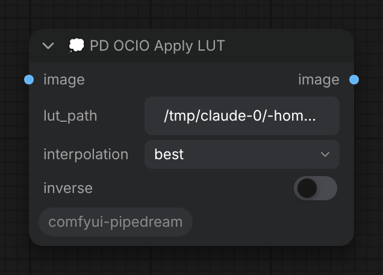
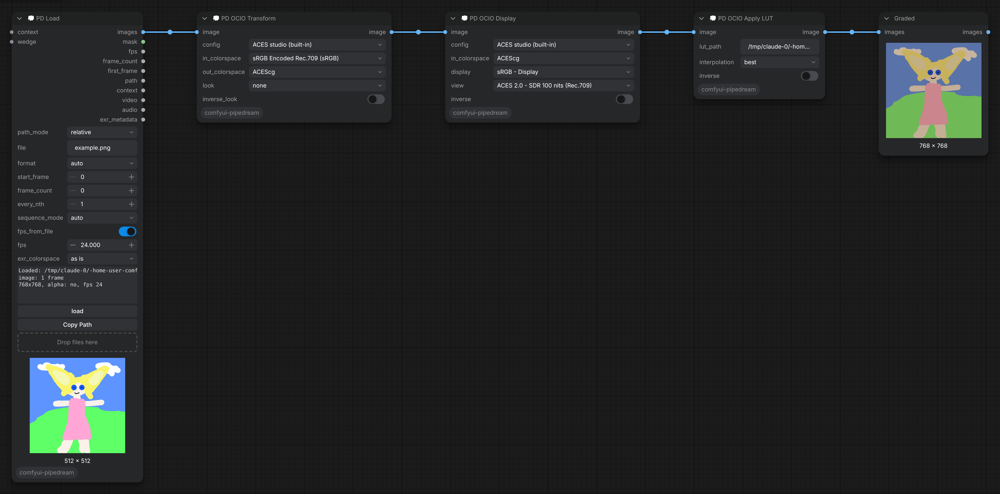

# PD OCIO Apply LUT

Applies a LUT file to an image with OpenColorIO, forward or inverse. Use it for show LUTs and looks kept as `.cube` or similar files, on local or network paths.

## Typical use
1. Set `lut_path` to the full path of the LUT (`\\server\luts\show_look.cube` or `/mnt/luts/show_look.cube`).
2. Convert the image to the colourspace the LUT expects first, with PD OCIO Transform.
3. Connect `image` in and out.

[05 Colour with OCIO](https://github.com/theonlyaaron/comfyui-pipedream/tree/main/workflows/05_color_ocio) includes this node bypassed: set `lut_path`, then un-bypass it (Ctrl+B).

## How it works
- Reads any LUT OpenColorIO reads: `.cube`, `.3dl`, `.csp`, `.spi1d`, `.spi3d`, CLF/CTF, CDL and others.
- The LUT sees the values as they are. It does not convert colourspace for you.
- `interpolation` for 3D LUTs: `best` (tetrahedral), `tetrahedral`, `linear` (trilinear) or `nearest`. 1D LUTs use linear for `best` and `tetrahedral`.
- `inverse` is exact for 1D LUTs and approximate for 3D LUTs.
- The node re-runs when the LUT file changes on disk.
- Float32 throughout; alpha is untouched.
- Needs OpenColorIO 2.3 or later. See [Install](https://github.com/theonlyaaron/comfyui-pipedream/blob/main/docs/install.md).

## Tips
- A bypassed node passes the image through, so you can leave it in a chain until a path is set.
- If the result looks wrong, the usual cause is the wrong input space for that LUT.

## See also
- [PD OCIO Transform](https://github.com/theonlyaaron/comfyui-pipedream/blob/main/web/docs/PDOCIOTransform.md), [PD OCIO Display](https://github.com/theonlyaaron/comfyui-pipedream/blob/main/web/docs/PDOCIODisplay.md), [PD Save](https://github.com/theonlyaaron/comfyui-pipedream/blob/main/web/docs/PDSave.md)
- [Install](https://github.com/theonlyaaron/comfyui-pipedream/blob/main/docs/install.md)

## Inputs and outputs
<!-- reference:start -->
<!-- Generated by tools/node_docs.py. Edit the node definition, not this block. -->

### Inputs

| Name | Type | Default | Required | Description |
|------|------|---------|----------|-------------|
| `image` | IMAGE |  | required |  |
| `lut_path` | STRING | `""` | required | Full path of the LUT file, e.g. \\server\luts\show_look.cube or /mnt/luts/show_look.cube. |
| `interpolation` | best, tetrahedral, linear, nearest | `best` | required | 3D LUTs: best (tetrahedral), tetrahedral, linear (trilinear) or nearest. 1D LUTs use linear for best/tetrahedral. |
| `inverse` | BOOLEAN | false | required | Apply the inverse of the LUT (exact for 1D LUTs, approximate for 3D LUTs). |

### Outputs

| Name | Type | Description |
|------|------|-------------|
| `image` | IMAGE |  |

This is not an output node: it runs only when another node needs its result.
<!-- reference:end -->
