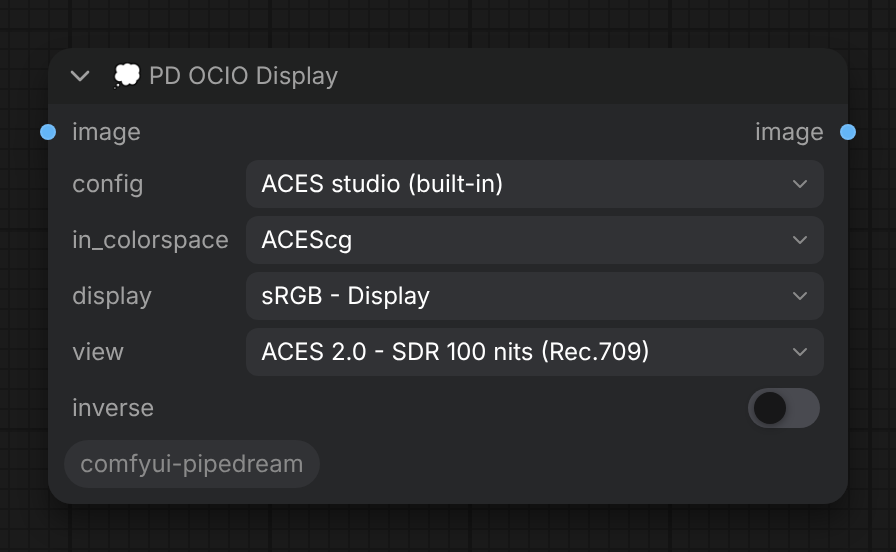
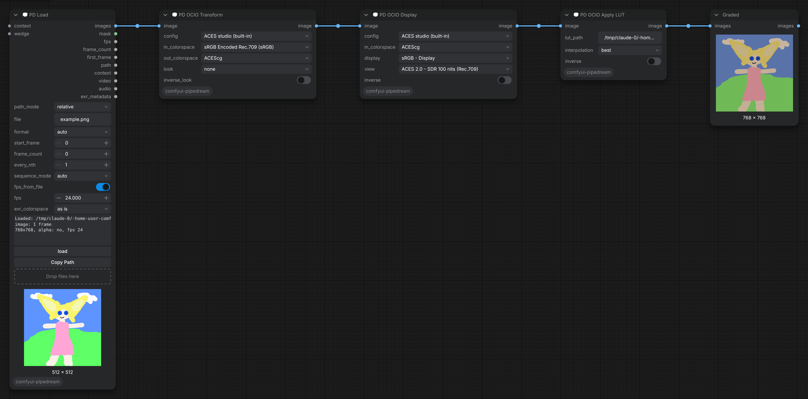

# PD OCIO Display

Applies an OpenColorIO display/view transform, such as the ACES output transform for an sRGB monitor, or its inverse. Use it to preview scene-linear images the way a display shows them.

## Typical use
1. Choose `config` and set `in_colorspace` to the scene space of the image (for example `ACEScg`).
2. Pick `display` and `view`.
3. Connect `image` in and the result to Preview Image.

[05 Colour with OCIO](https://github.com/theonlyaaron/comfyui-pipedream/tree/main/workflows/05_color_ocio) applies the ACES 2.0 SDR output transform.

## How it works
- **config** works as on [PD OCIO Transform](https://github.com/theonlyaaron/comfyui-pipedream/blob/main/web/docs/PDOCIOTransform.md): `$OCIO environment`, the built-in ACES configs, or `custom file` with `config_path`.
- `view` follows `display`: the list changes when you change the display.
- `inverse` converts a display image back to `in_colorspace`.
- Float32 throughout; alpha is untouched.
- Needs OpenColorIO 2.3 or later. See [Install](https://github.com/theonlyaaron/comfyui-pipedream/blob/main/docs/install.md).

## Tips
- This node is for viewing or delivery. Keep the working image scene-linear and apply the display transform on a branch.
- Defaults come from the `[ocio]` settings (`display`, `view`). See [Settings](https://github.com/theonlyaaron/comfyui-pipedream/blob/main/docs/settings.md).

## See also
- [PD OCIO Transform](https://github.com/theonlyaaron/comfyui-pipedream/blob/main/web/docs/PDOCIOTransform.md), [PD OCIO Apply LUT](https://github.com/theonlyaaron/comfyui-pipedream/blob/main/web/docs/PDOCIOApplyLUT.md), [PD Save](https://github.com/theonlyaaron/comfyui-pipedream/blob/main/web/docs/PDSave.md)
- [Install](https://github.com/theonlyaaron/comfyui-pipedream/blob/main/docs/install.md), [Settings](https://github.com/theonlyaaron/comfyui-pipedream/blob/main/docs/settings.md)

## Inputs and outputs
<!-- reference:start -->
<!-- reference:end -->
