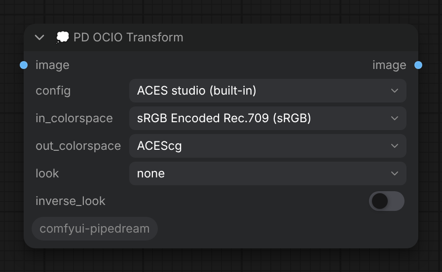
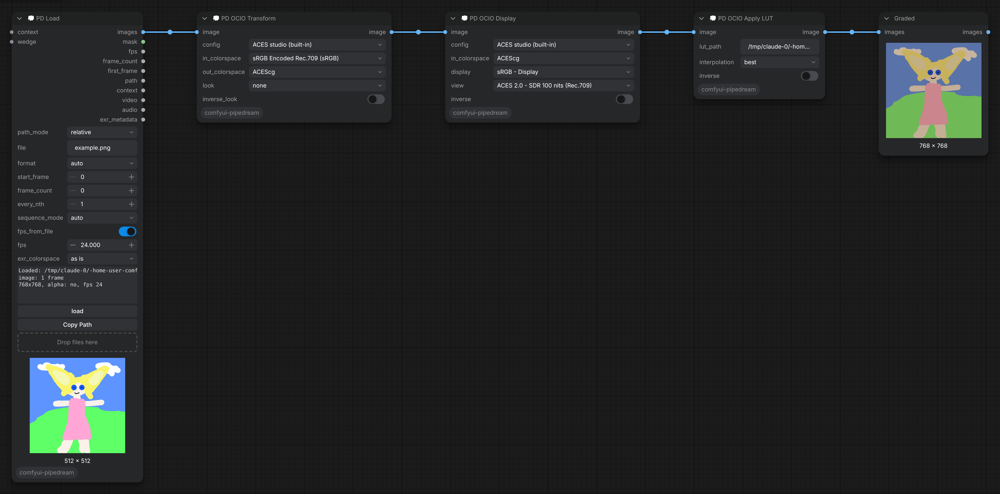

# PD OCIO Transform

Converts an image between two OpenColorIO colourspaces, optionally through a look. Use it to move generated sRGB images into scene-linear `ACEScg` before writing EXR, or between any two spaces of a studio config.

## Typical use
1. Choose `config` (the built-in ACES studio config works with no setup).
2. Set `in_colorspace` and `out_colorspace` (`ACEScg`).
3. Connect `image` in and out. Write the result with PD Save as EXR, with `exr_colorspace` **as is**.

[05 Colour with OCIO](https://github.com/theonlyaaron/comfyui-pipedream/tree/main/workflows/05_color_ocio) converts sRGB to `ACEScg` and writes `color_acescg.exr`.

## How it works
- **config:** `$OCIO environment` (the config in the `OCIO` variable, else the built-in ACES studio config), `ACES studio (built-in)`, `ACES cg (built-in)`, or `custom file` (then `config_path` is shown).
- **Dropdowns** follow the selected config. Aliases and roles (`scene_linear`, `srgb_tx`) work, and names are checked when you queue.
- **look** applies a named grade from the config between the two spaces; `inverse_look` applies its inverse. The built-in configs have one look; studio configs add show looks.
- Linear spaces such as `Linear Rec.709 (sRGB)`, `Linear Rec.2020` and `ACEScg` are in the built-in configs. If the lists show only two colourspaces, OpenColorIO is not installed.
- Float32 throughout: values outside 0 to 1 survive. Alpha is untouched.
- Configs and processors are cached and re-read when the file changes.
- Needs OpenColorIO 2.3 or later (`opencolorio`). See [Install](https://github.com/theonlyaaron/comfyui-pipedream/blob/main/docs/install.md).

## Tips
- PD Save's `exr_colorspace` **sRGB to linear** is a simple sRGB decode with no OCIO. Use this node for anything else.
- Defaults come from the `[ocio]` settings (`config`, `config_path`, `in_colorspace`, `out_colorspace`). See [Settings](https://github.com/theonlyaaron/comfyui-pipedream/blob/main/docs/settings.md).

## See also
- [PD OCIO Display](https://github.com/theonlyaaron/comfyui-pipedream/blob/main/web/docs/PDOCIODisplay.md), [PD OCIO Apply LUT](https://github.com/theonlyaaron/comfyui-pipedream/blob/main/web/docs/PDOCIOApplyLUT.md), [PD Save](https://github.com/theonlyaaron/comfyui-pipedream/blob/main/web/docs/PDSave.md), [PD Load](https://github.com/theonlyaaron/comfyui-pipedream/blob/main/web/docs/PDLoad.md)
- [Install](https://github.com/theonlyaaron/comfyui-pipedream/blob/main/docs/install.md), [Settings](https://github.com/theonlyaaron/comfyui-pipedream/blob/main/docs/settings.md)

## Inputs and outputs
<!-- reference:start -->
<!-- reference:end -->
