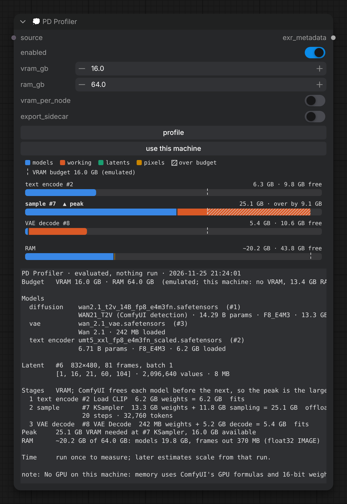
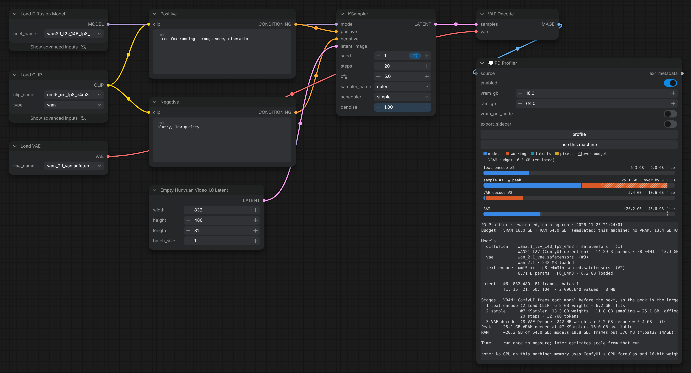

# PD Profiler

Reports what everything upstream of its `source` input will cost: models, latent sizes, VRAM and RAM per stage, time and API nodes. It evaluates without running the graph, and measures real runs. Use it to find out whether a workflow fits a card before you queue it.

## Typical use
1. Connect `source` to anything: PD Save's `images`, or a branch off a flow.
2. Press **profile**. The report and chart appear on the node without queuing anything.
3. Set `vram_gb` and `ram_gb` to budget against another machine, such as a farm node's card.
4. Run the graph. With `enabled` on, the report adds measured node times and the run's VRAM peak.

[06 Wedge basics](https://github.com/theonlyaaron/comfyui-pipedream/tree/main/workflows/06_wedge_basics) puts a profiler after PD Save, with a sidecar per wedge job.

<!-- media: clip, 10 s: the profiler chart updating after a run -->

## How it works

### What it profiles
- Only what `source` reads from. Several flows in one graph each get their own numbers.
- Nothing needs typing in: the numbers come from the graph, the model files, ComfyUI's own formulas and this machine.

### Models
- Each loader's file is identified from its header (safetensors and GGUF tensor tables; no weights are loaded) with ComfyUI's own model detection, so renamed files still match.
- It reports parameters, data type and the bytes ComfyUI keeps in memory. LoRAs are listed.
- If detection fails, the file name is matched instead and the report says so.

### Latent
- The exact shape from the latent node's widgets, with ComfyUI's rounding down.
- A size that loses pixels (1080 high on a 16 px model decodes to 1072) or a frame count that is not 4k+1 or 8k+1 is flagged with the values to use.

### Memory by stage
- ComfyUI frees each model before the next, so memory is reported per stage: text encode, each sampler (weights, ComfyUI's `memory_required`, latent; Wan 2.2's two experts are two stages) and each VAE decode (weights plus the decode estimate, per tile for tiled decode).
- Each stage reads **fits**, **offloads** (with how much) or **over budget** against the VRAM budget. The peak is the largest stage.
- RAM is model weights plus decoded frames (float32).

### Chart
- One horizontal bar per stage, split into models, working memory and latents, running toward a dashed VRAM-budget line. Each bar shows its total and how much is free or how far over.
- The part past the line is hatched: that is what to cut (resolution, frames, batch, weight precision) until every bar is under.
- The peak stage is marked. Measured times appear after a run, with a solid line for the measured peak. A RAM bar shows weights and decoded pixels against the RAM budget. Hover a bar for its numbers.

### Budget
- `vram_gb` and `ram_gb` emulate another machine. 0 means this machine.
- **use this machine** fills in this machine's values.
- Without a GPU, the profile uses ComfyUI's GPU formulas and 16-bit data types.

### Time
- After a run, each node's time is kept on the node and saved with the workflow. Later evaluations scale sampler times by steps and latent size.
- With wedges: a once-per-queue part (loaders, encoders, nodes before the wedge) plus the per-job part times the job count.

### Wedges
- Only the selected row's branch is followed: the queued row, else `solo`, else row 1.
- The report shows the job count and says when rows read from different branches.

### API nodes
- They count as zero (they run off-site) and are flagged at the top, since their inputs leave the machine.

### Measured runs
- `enabled` makes the node run with the graph. It adds each upstream node's time (or "cached"), the run's VRAM peak, the models ComfyUI holds and the input received.
- `vram_per_node` also measures each node's VRAM peak. It resets torch's peak counter as each node starts, so it is off by default (see its tooltip).
- With `enabled` off the node does nothing on runs; **profile** still works.
- The node runs on every queue.

### Sidecar
- With `export_sidecar` on, the profile is written as JSON after each run.
- Link PD Save's `path` into `path` to write `<name>.profile.json` next to the output (frame number dropped). Otherwise type a folder, or leave it empty for `output/pipedream_profiles/`.
- `path` is shown only while `export_sidecar` is on or `path` is linked.

### EXR metadata output
- The `exr_metadata` output stamps the run as `pipedream/profiler/...` attributes for PD Save: budget, the peak estimate and its stage, each stage, the latent, model file paths, measured time and VRAM peak. See [EXR metadata](https://github.com/theonlyaaron/comfyui-pipedream/blob/main/docs/exr-metadata.md).
- Branch the profiler off before PD Save to use it. A profiler after PD Save, feeding back into it, would be a loop.
- The profile changes every run, so a PD Save fed by it writes on every queue.
- With `enabled` off the output is empty.

### Limits
- Memory figures are ComfyUI's own estimates (the ones it loads and offloads by), not measurements, and sampling memory tends to read high.
- Text encoder activations, LoRA patch memory and custom samplers with their own memory handling are not modelled.
- Latent sizes computed at run time are reported as only known at run time.

This page covers the node. Where each number comes from, the sidecar format and use without the browser: [Profiler reference](https://github.com/theonlyaaron/comfyui-pipedream/blob/main/docs/profiler.md).

## Tips
- Branch the profiler off the flow rather than after PD Save when you want its output as EXR metadata.
- Compare the estimate with a measured run's peak on your own hardware before trusting a tight fit.
- To profile a flow with no Save node, connect `source` to any output of the last node.
- `[profiler]` settings set defaults (`enabled`, `vram_gb`, `ram_gb`, `vram_per_node`, `export_sidecar`). See [Settings](https://github.com/theonlyaaron/comfyui-pipedream/blob/main/docs/settings.md).

## See also
- [PD Save](https://github.com/theonlyaaron/comfyui-pipedream/blob/main/web/docs/PDSave.md), [PD Wedge](https://github.com/theonlyaaron/comfyui-pipedream/blob/main/web/docs/PDWedge.md), [PD EXR Metadata Get](https://github.com/theonlyaaron/comfyui-pipedream/blob/main/web/docs/PDExrMetadataGet.md)
- Topic pages: [Profiler reference](https://github.com/theonlyaaron/comfyui-pipedream/blob/main/docs/profiler.md), [EXR metadata](https://github.com/theonlyaaron/comfyui-pipedream/blob/main/docs/exr-metadata.md), [Settings](https://github.com/theonlyaaron/comfyui-pipedream/blob/main/docs/settings.md)

## Inputs and outputs
<!-- reference:start -->
<!-- Generated by tools/node_docs.py. Edit the node definition, not this block. -->

### Inputs

| Name | Type | Default | Required | Description |
|------|------|---------|----------|-------------|
| `source` | any |  | required | Anything. Everything this input reads from is profiled; other flows in the graph are ignored. Put it after PD Output or branch it off a flow. |
| `enabled` | BOOLEAN | true | optional | Run with queued runs and report what was measured. Off: the node does nothing on runs (the profile button still works). |
| `vram_gb` | FLOAT | `0.0` | optional | GPU memory to budget against, in GB, e.g. a farm node's card. 0: this machine. 'use this machine' fills in this machine's. |
| `ram_gb` | FLOAT | `0.0` | optional | System memory to budget against, in GB. 0: this machine. |
| `vram_per_node` | BOOLEAN | false | optional | Also measure the VRAM peak of each node during runs. ComfyUI has no 'node started' signal for custom nodes, so this listens to the progress messages it already sends and resets torch's peak counter at each node. It changes nothing in the run; off by default because it touches a ComfyUI internal. Without it you still get node times and the run's overall VRAM peak. |
| `export_sidecar` | BOOLEAN | false | optional | Write the profile as JSON after each run: next to 'path' (<name>.profile.json), or in output/pipedream_profiles. |
| `path` | STRING | `""` | optional | Where the sidecar goes: link PD Save's path to write it next to the output, or type a folder. Empty: output/pipedream_profiles. |

### Outputs

| Name | Type | Description |
|------|------|-------------|
| `exr_metadata` | EXR_METADATA | This run's profile as EXR metadata under pipedream/profiler/ (budget, peak, each stage, latent, model paths, measured time and VRAM), for PD Save's exr_metadata. To use it, branch the profiler off before PD Save (after it would be a loop). |

This is an output node: it runs whenever it is in the graph, even with nothing connected after it.
<!-- reference:end -->
