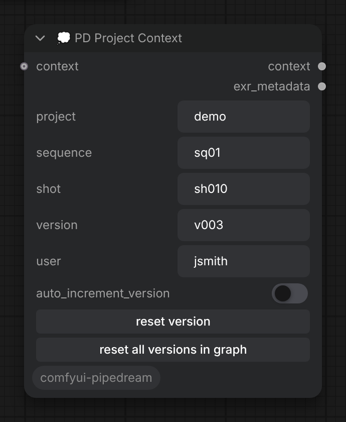
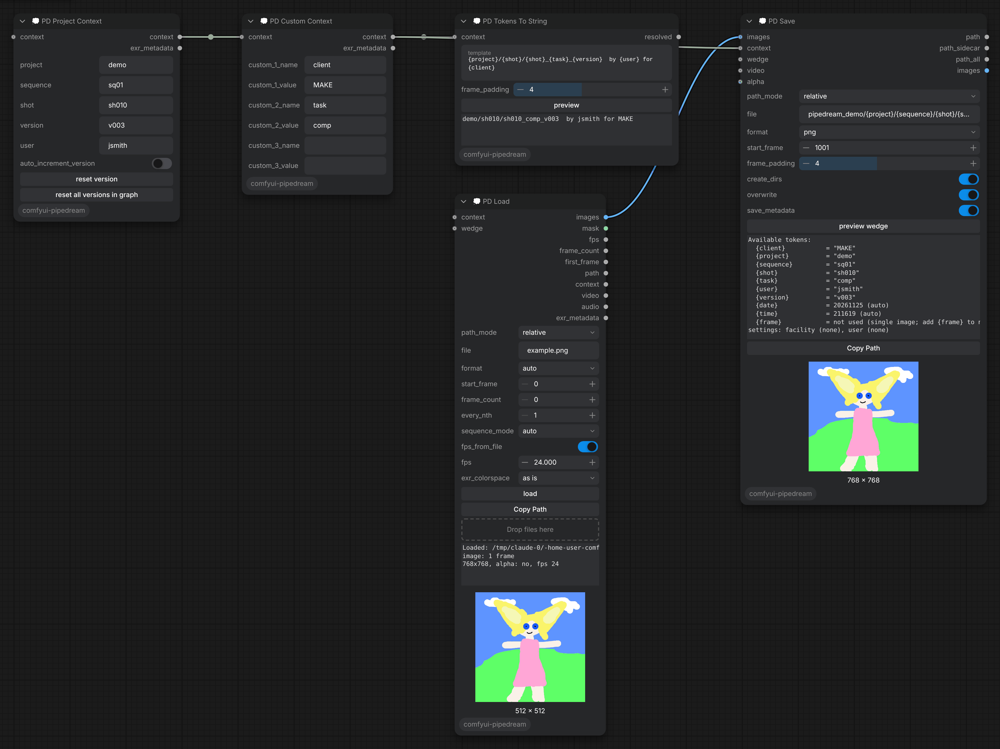

# PD Project Context

Holds the shot details of a workflow (`project`, `sequence`, `shot`, `version`, `user`) and turns each into a token. Use it as the root token source for PD Save, PD Load and PD Tokens To String, so a path is built from shot details instead of typed by hand.

## Typical use
1. Fill in `project`, `sequence`, `shot` and `version`.
2. Connect `context` to PD Custom Context, PD Save, PD Load or PD Tokens To String.
3. Use `{project}`, `{shot}`, `{version}` and the rest in their templates.
4. Connect `exr_metadata` to PD Save (or PD EXR Metadata Merge) to stamp the same values into EXR headers.

[01 Tokens](https://github.com/theonlyaaron/comfyui-pipedream/tree/main/workflows/01_tokens) shows the tokens and previews them. [02 Load and save](https://github.com/theonlyaaron/comfyui-pipedream/tree/main/workflows/02_load_and_save) carries them into an EXR sequence's header.

## How it works

### Tokens
- Each widget becomes a token of the same name: `{project}`, `{sequence}`, `{shot}`, `{version}`, `{user}`.
- Token syntax and the full list: [Tokens](https://github.com/theonlyaaron/comfyui-pipedream/blob/main/docs/tokens.md).

### Chaining
- `context` accepts an incoming context. Non-empty widgets override it; empty ones pass it through.
- Set a base and override per shot: Project Context (`project`, `sequence`) into Project Context (`shot`) into Custom Context (`task`) into PD Save.

### Versioning
- `version` is a prefix plus a number (`v001`, `take_0042`). Padding is kept (`v009` becomes `v010`). A value without trailing digits is left unchanged.
- With `auto_increment_version` on, each queued prompt uses the current version and the widget then advances, like a seed's `control_after_generate`. Batch count 5 from `v001` runs `v001` to `v005`.
- It does not advance while `version` is linked from another node.
- **reset version** returns this node to its first version (`v017` becomes `v001`; `take_0042` becomes `take_0001`). A value with no number falls back to the `project.version` setting.
- **reset all versions in graph** resets every PD Project Context in the workflow, subgraphs included, after a confirmation. It is also in the canvas menu as *Pipedream: reset all versions*.

### EXR metadata
- `exr_metadata` outputs every token as a string attribute named `pipedream/<token>` (the prefix is the `exr.metadata_prefix` setting). Empty values are left out. See [EXR metadata](https://github.com/theonlyaaron/comfyui-pipedream/blob/main/docs/exr-metadata.md).

## Tips
- `user` is optional and sits below the context input; fill it for `{user}` in paths.
- Defaults for `version` and `auto_increment_version` come from the `[project]` settings. See [Settings](https://github.com/theonlyaaron/comfyui-pipedream/blob/main/docs/settings.md).

## See also
- [PD Custom Context](https://github.com/theonlyaaron/comfyui-pipedream/blob/main/web/docs/PDCustomContext.md), [PD Tokens To String](https://github.com/theonlyaaron/comfyui-pipedream/blob/main/web/docs/PDTokensToString.md), [PD Save](https://github.com/theonlyaaron/comfyui-pipedream/blob/main/web/docs/PDSave.md), [PD Load](https://github.com/theonlyaaron/comfyui-pipedream/blob/main/web/docs/PDLoad.md)
- Topic pages: [Tokens](https://github.com/theonlyaaron/comfyui-pipedream/blob/main/docs/tokens.md), [EXR metadata](https://github.com/theonlyaaron/comfyui-pipedream/blob/main/docs/exr-metadata.md), [Settings](https://github.com/theonlyaaron/comfyui-pipedream/blob/main/docs/settings.md)

## Inputs and outputs
<!-- reference:start -->
<!-- reference:end -->
