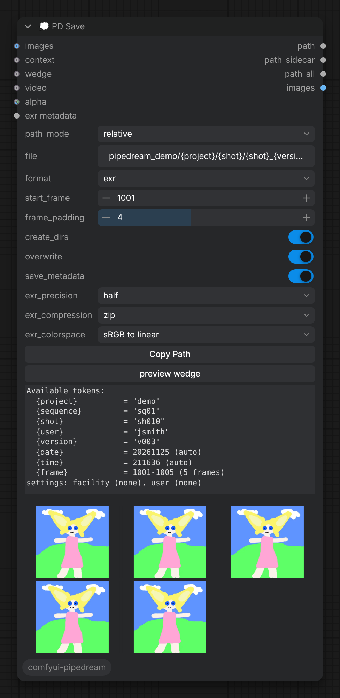
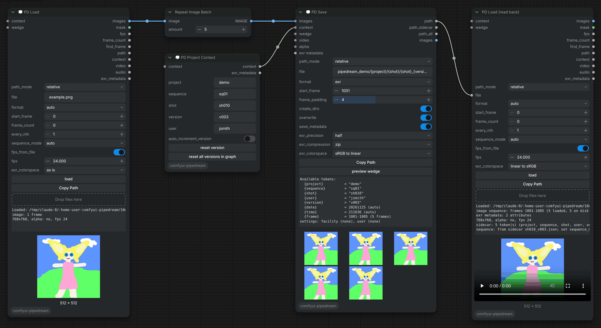
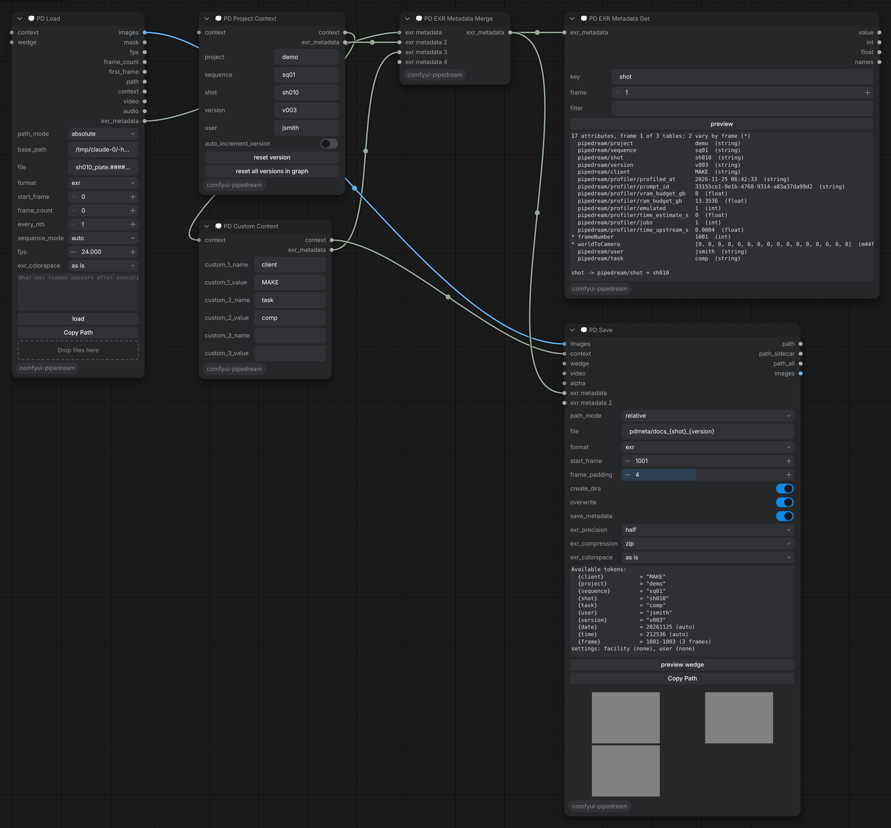

# PD Save

Writes images (png, exr, jpg, webp) or video (mp4, mov, webm) to a path built from a token template, with alpha, EXR metadata and a sidecar JSON that records how the file was made. Use it in place of Save Image when files need predictable names on local or network storage.

PD Save was called PD Output before 0.3.0. Old workflows still load.

## Typical use
1. Put a PD Project Context (and optionally a PD Custom Context) upstream and connect its `context` to PD Save.
2. Set `file` to a template such as `{project}/{shot}/{shot}_{version}.{frame}`, pick a `format`, and connect `images` (or `video`).
3. Press **preview wedge** or run the graph. The panel lists every token and its value, and the preview shows what was written.
4. Press **Copy Path** to paste the first file's full path into Explorer, Finder or Nuke.

[02 Load and save](https://github.com/theonlyaaron/comfyui-pipedream/tree/main/workflows/02_load_and_save) writes an EXR sequence with a sidecar and header metadata, then reads it back. [06 Wedge basics](https://github.com/theonlyaaron/comfyui-pipedream/tree/main/workflows/06_wedge_basics) names files with a wedge token.

## How it works

### Where files go
- `path_mode` **relative** resolves `file` under ComfyUI's output folder. **absolute** resolves it under `base_path` (`C:\Shots`, `/mnt/shows`, `\\server\shows`; UNC works).
- Relative paths cannot leave the output folder.
- `create_dirs` makes missing folders. With `overwrite` off, nothing is written if the file, or any frame of a sequence, already exists.
- The `file` input is called `template` in API prompts and in the settings (`output.template`).

### Tokens
- `file` is a token template: `{project}`, `{sequence}`, `{shot}`, `{version}`, `{user}`, your own custom tokens, `{date}`, `{time}`, wedge tokens and `[tokens.extra]` settings.
- Wedge tokens (`{<token>}`, `{<token>_idx}`, `{wedge_idx}`, `{wedge_total}`) override context tokens of the same name.
- Unknown tokens stay as `{name}` in the path. Full syntax: [Tokens](https://github.com/theonlyaaron/comfyui-pipedream/blob/main/docs/tokens.md).

### Formats
- **Image formats** write one file per frame: png, exr, jpg, webp.
- **Video formats**: mp4 (H.264, `crf` sets quality), mov (ProRes), webm (VP9). Encoding uses PyAV, so no ffmpeg install is needed. Audio is written as AAC or Opus; odd sizes are padded to even.
- A connected `video` keeps its own frame rate and audio. With an image format its frames become a sequence. `fps` applies to `images` only.
- `prores_profile` (mov only): **auto** picks 4444 when there is alpha, else 422 HQ.

### Sequences
- `{frame}` places the frame number, starting at `start_frame` with `frame_padding` digits (`{shot}_{version}.{frame}` gives `sh010_v001.1001.exr`).
- Without `{frame}`, a batch of more than one frame gets `.1001` before the extension. The `sequence.frame_separator` setting can change the dot to `_` or `-`. A single image gets no number.
- Video formats drop `{frame}`.

### EXR
- `exr_precision` is `half` or `float`; `exr_compression` is `zip`, `zips`, `rle` or `none`. Values are not clipped.
- `exr_colorspace` **sRGB to linear** decodes sRGB images with the sRGB curve (no OCIO). **as is** writes values unchanged. For other spaces, put [PD OCIO Transform](https://github.com/theonlyaaron/comfyui-pipedream/blob/main/web/docs/PDOCIOTransform.md) first.
- **exr metadata** inputs write header attributes. They appear for exr only, with a spare one after the last connected (up to 8). They are merged frame by frame, later inputs winning on the same name. With none connected, no metadata is written beyond FFmpeg's defaults (`writer`, `gamma`). See [EXR metadata](https://github.com/theonlyaaron/comfyui-pipedream/blob/main/docs/exr-metadata.md).

### Alpha
- Alpha comes from the `alpha` input (a MASK, or an IMAGE or VIDEO's luminance; one frame or one per frame) or from the images' fourth channel.
- Written to png/webp (straight), exr (premultiplied) and mov ProRes 4444 (straight). jpg, mp4, webm and ProRes 422 HQ cannot store alpha: it is skipped with a console warning.
- Masks use 1.0 = opaque. Core Load Image's mask is inverted, so put Invert Mask in between. See [Alpha](https://github.com/theonlyaaron/comfyui-pipedream/blob/main/docs/alpha.md).

### Sidecar
- With `save_metadata` on, `<name>.json` is written next to the output (frame number dropped). It holds the template, tokens, context, files, frame range and pattern, alpha convention, wedge job, settings files, the ComfyUI prompt and the workflow.
- [PD Load](https://github.com/theonlyaaron/comfyui-pipedream/blob/main/web/docs/PDLoad.md) reads it back. Drop the sidecar on the ComfyUI canvas to reopen the workflow that wrote it.

### Outputs
- `path` is the first file (the first frame of a sequence), `path_sidecar` the sidecar, `path_all` every file one per line.
- `images` passes the input through. `video` returns the written video and exists for video formats only.

### Buttons and panels
- **preview wedge** lists the path every wedge job would write, without running the graph. It shows the job count and warns about wedges not chained into PD Save, paths written by more than one job, and existing files. See [Wedges](https://github.com/theonlyaaron/comfyui-pipedream/blob/main/docs/wedges.md).
- **Copy Path** copies the last written file's full path. It works from any browser, and the path is stored on the node so it survives a save.
- The panel lists every token with its value after a run. The preview shows what was written; EXR, ProRes and files outside the output folder get a downscaled preview, and video plays as a clip.

<!-- media: clip, 10 s: Copy Path after a run, pasted into a file browser -->

### What is hidden when
Widgets and sockets that do not apply are hidden, never while linked:
- `base_path` in relative mode.
- `start_frame` and `frame_padding` for video formats.
- `fps` for image formats, or while a `video` is connected; `crf` for image formats and mov.
- `prores_profile` unless mov.
- `exr_precision`, `exr_compression`, `exr_colorspace` and the exr metadata inputs unless exr.
- The `alpha` input for formats without alpha.
- The `video` output for image formats.

## Tips
- Use a version token in `file` and turn on `auto_increment_version` on PD Project Context so each queue writes a new version.
- Leave `overwrite` off while testing: a clash is reported instead of silently replaced.
- Loading an EXR and writing it back strips its metadata unless you connect PD Load's `exr_metadata`.
- Put `{wedge_idx}` or the wedge token in the template, or wedge jobs overwrite each other.
- The `[output]` settings table sets defaults for studios (`output.template`, `output.format`, `output.base_path` and more). See [Settings](https://github.com/theonlyaaron/comfyui-pipedream/blob/main/docs/settings.md).

## See also
- [PD Load](https://github.com/theonlyaaron/comfyui-pipedream/blob/main/web/docs/PDLoad.md) reads back what PD Save wrote.
- [PD Wedge](https://github.com/theonlyaaron/comfyui-pipedream/blob/main/web/docs/PDWedge.md), [PD Project Context](https://github.com/theonlyaaron/comfyui-pipedream/blob/main/web/docs/PDProjectContext.md), [PD Custom Context](https://github.com/theonlyaaron/comfyui-pipedream/blob/main/web/docs/PDCustomContext.md)
- [PD EXR Metadata Merge](https://github.com/theonlyaaron/comfyui-pipedream/blob/main/web/docs/PDExrMetadataMerge.md), [PD Profiler](https://github.com/theonlyaaron/comfyui-pipedream/blob/main/web/docs/PDProfiler.md)
- Topic pages: [Tokens](https://github.com/theonlyaaron/comfyui-pipedream/blob/main/docs/tokens.md), [EXR metadata](https://github.com/theonlyaaron/comfyui-pipedream/blob/main/docs/exr-metadata.md), [Alpha](https://github.com/theonlyaaron/comfyui-pipedream/blob/main/docs/alpha.md), [Settings](https://github.com/theonlyaaron/comfyui-pipedream/blob/main/docs/settings.md)

## Inputs and outputs
<!-- reference:start -->
<!-- reference:end -->
