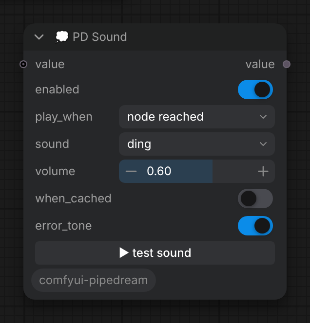

# PD Sound

Plays a sound in the browser when its point in the graph runs, or when the whole queue finishes. Use it to hear progress through a long graph, or to be told when a queue is done.

## Typical use
1. Inline: wire anything through `value` (it passes on untouched). With `play_when` **node reached**, the sound plays when the flow gets there.
2. Or leave it dangling with **queue finished** to hear one cue when everything is done.
3. Press **test sound** to preview.

[04 Sound](https://github.com/theonlyaaron/comfyui-pipedream/tree/main/workflows/04_sound) has an inline `ding`, a `chime` at the end of the queue, and the error buzzer.

<!-- media: clip, 10 s: an inline ding partway through a run, then the chime at the end -->

## How it works

### When it plays
- **node reached** plays when the node runs, so several nodes can announce stages, each with its own sound.
- **queue finished** plays once the queue drains. A node with nothing connected always waits for the queue, whatever `play_when` says.
- Cached nodes do not run and are not forced to; `when_cached` also plays for them. The widget is hidden in **queue finished** mode.
- If a run fails, `error_tone` plays a buzzer instead. If the queue is interrupted, nothing plays.
- `enabled` turns the node off.

### Sounds
- `chime`, `happy`, `sad`, `ding`, `beeps`, `alert` are synthesized in the browser. `custom URL` plays a file from `custom_url` (shown only for that choice).
- Each node has its own `sound` and `volume`.
- Sounds play in the browser tab that queued the run.

## Tips
- Browsers may block audio until you have interacted with the page; **test sound** counts.
- Defaults come from the `[sound]` settings (`sound`, `volume`, `play_when`). See [Settings](https://github.com/theonlyaaron/comfyui-pipedream/blob/main/docs/settings.md).

## See also
- [PD Save](https://github.com/theonlyaaron/comfyui-pipedream/blob/main/web/docs/PDSave.md), [PD Profiler](https://github.com/theonlyaaron/comfyui-pipedream/blob/main/web/docs/PDProfiler.md)
- [Settings](https://github.com/theonlyaaron/comfyui-pipedream/blob/main/docs/settings.md)

## Inputs and outputs
<!-- reference:start -->
<!-- reference:end -->
