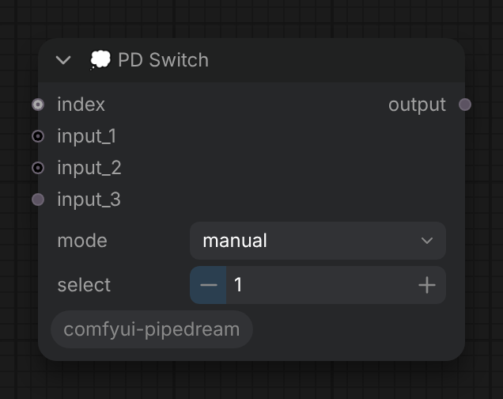
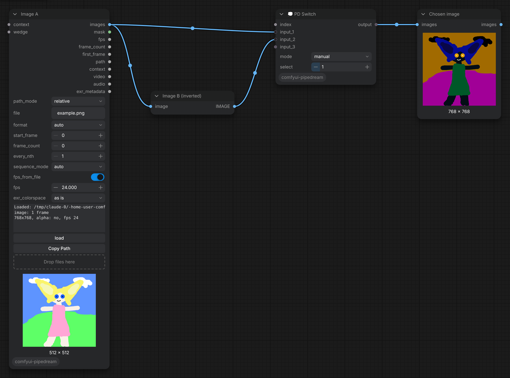

# PD Switch

Routes one of up to 8 inputs, of any type, to a single output. Use it to pick between alternatives (two frames, two models, two prompts) from one widget or from a number computed elsewhere.

## Typical use
1. Connect the alternatives to `input_1`, `input_2`... A spare input appears as you connect each.
2. Set `select` to the one you want (0 is the first input).
3. Connect `output` onward.

[03 Video frames](https://github.com/theonlyaaron/comfyui-pipedream/tree/main/workflows/03_video_frames) switches between two frames with `select` 0 or 1.

## How it works
- **Inputs:** 2 to 8, auto-growing. There is always one spare after the highest connected input, and unused ones at the end shrink away.
- **mode `manual`:** the `select` widget chooses. **`value`:** the `index` input (an INT you link in) chooses.
- **Numbering:** `select` and `index` count from 0. 0 picks `input_1`, 7 picks `input_8`. Values outside 0 to 7 are clamped.
- **Types:** inputs and output are wildcards, so any type passes.
- Picking an input that is not connected gives an empty output.

## Tips
- Drive `index` (with `mode` `value`) from a wedge's `int` output to switch inputs per wedge job.
- Mixed types are allowed, but only the downstream node's own type check will complain about a wrong one.

## See also
- [PD Wedge](https://github.com/theonlyaaron/comfyui-pipedream/blob/main/web/docs/PDWedge.md), [PD Image From Batch](https://github.com/theonlyaaron/comfyui-pipedream/blob/main/web/docs/PDImageFromBatch.md), [PD Video Get Frame](https://github.com/theonlyaaron/comfyui-pipedream/blob/main/web/docs/PDVideoGetFrame.md)

## Inputs and outputs
<!-- reference:start -->
<!-- reference:end -->
