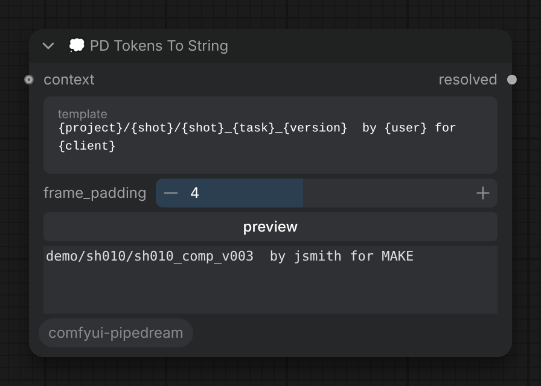
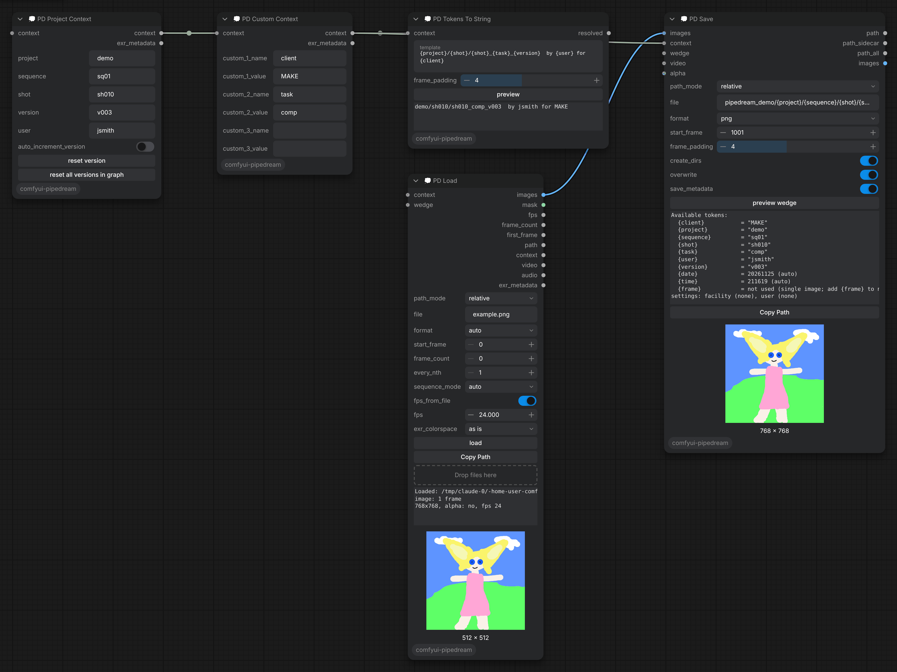

# PD Tokens To String

Resolves a token template to plain text. Use it for prompts, titles, or the path widgets of other nodes, and to check what a template will give before PD Save writes anything.

## Typical use
1. Connect a context (PD Project Context, PD Custom Context) to `context`.
2. Type a `template`, for example `{shot} {task} {version} by {user}`.
3. Press **preview**. The result appears in the node's panel without running anything else.
4. Connect `resolved` to any STRING input.

[01 Tokens](https://github.com/theonlyaaron/comfyui-pipedream/tree/main/workflows/01_tokens) has three templates with their results.

## How it works
- Tokens come from `context` plus the automatic `{date}` (`YYYYMMDD`), `{time}` (`HHMMSS`) and `{frame}`.
- Here `{frame}` resolves to `####` (as many `#` as `frame_padding`, 1 to 8), so a template can show a sequence path.
- Unknown tokens stay as `{name}` in the output.
- Delimiters, date and time formats and `[tokens.extra]` settings apply here too.
- It is an output node, so **preview** can run just it and its inputs. The resolved text is also shown after every run.
- The default `template` comes from the `[tokens_to_string]` settings.
- Full token list and syntax: [Tokens](https://github.com/theonlyaaron/comfyui-pipedream/blob/main/docs/tokens.md).

## Tips
- Build a path here and wire `resolved` into another node to see exactly what it will receive.
- Wedge tokens are not available here: the node has no `wedge` input.

## See also
- [PD Project Context](https://github.com/theonlyaaron/comfyui-pipedream/blob/main/web/docs/PDProjectContext.md), [PD Custom Context](https://github.com/theonlyaaron/comfyui-pipedream/blob/main/web/docs/PDCustomContext.md), [PD Save](https://github.com/theonlyaaron/comfyui-pipedream/blob/main/web/docs/PDSave.md), [PD Load](https://github.com/theonlyaaron/comfyui-pipedream/blob/main/web/docs/PDLoad.md)
- [Tokens](https://github.com/theonlyaaron/comfyui-pipedream/blob/main/docs/tokens.md), [Settings](https://github.com/theonlyaaron/comfyui-pipedream/blob/main/docs/settings.md)

## Inputs and outputs
<!-- reference:start -->
<!-- reference:end -->
