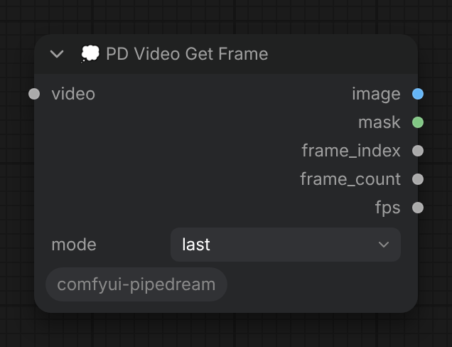
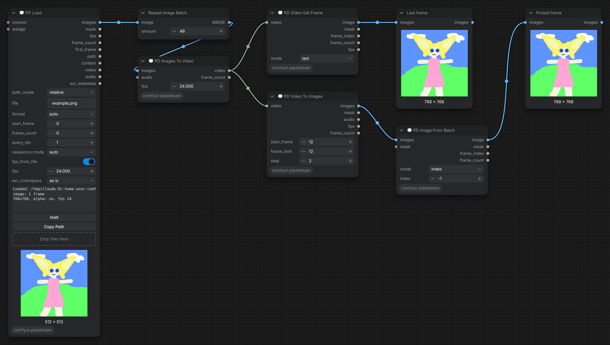

# PD Video Get Frame

Grabs one frame from a `VIDEO` (first, last, or by index) without decoding the whole clip. Use it for a thumbnail, a last frame to continue from, or a quick check.

## Typical use
1. Connect `video`.
2. Set `mode` to `first`, `last` or `index`. For `index`, set `index`.
3. Use `image` and `mask`.

[03 Video frames](https://github.com/theonlyaaron/comfyui-pipedream/tree/main/workflows/03_video_frames) seeks to the `last` frame.

## How it works
- It seeks to the nearest keyframe and decodes only what is needed.
- Negative `index` counts from the end (-1 is the last frame). `index` is shown only when `mode` is `index`.
- `last` and negative indices find the real end even when the container's frame count is wrong.
- Out-of-range indices clamp. `frame_index` reports the frame used; `frame_count` is exact for `last` and negative indices.
- `image` is float32 RGB; `mask` is the alpha (1.0 = opaque), full opacity when there is none.
- Seeking assumes a constant frame rate.

## Tips
- Several frames: use [PD Video To Images](https://github.com/theonlyaaron/comfyui-pipedream/blob/main/web/docs/PDVideoToImages.md) with `frame_limit`.
- A frame from an image batch: [PD Image From Batch](https://github.com/theonlyaaron/comfyui-pipedream/blob/main/web/docs/PDImageFromBatch.md).

## See also
- [PD Video To Images](https://github.com/theonlyaaron/comfyui-pipedream/blob/main/web/docs/PDVideoToImages.md), [PD Image From Batch](https://github.com/theonlyaaron/comfyui-pipedream/blob/main/web/docs/PDImageFromBatch.md), [PD Switch](https://github.com/theonlyaaron/comfyui-pipedream/blob/main/web/docs/PDSwitch.md), [PD Load](https://github.com/theonlyaaron/comfyui-pipedream/blob/main/web/docs/PDLoad.md)

## Inputs and outputs
<!-- reference:start -->
<!-- Generated by tools/node_docs.py. Edit the node definition, not this block. -->

### Inputs

| Name | Type | Default | Required | Description |
|------|------|---------|----------|-------------|
| `video` | VIDEO |  | required |  |
| `mode` | first, last, index | `first` | required | first / last frame, or the frame at 'index'. |
| `index` | INT | `0` | required | Frame index used when mode is 'index'. Negative values count from the end (-1 = last). |

### Outputs

| Name | Type | Description |
|------|------|-------------|
| `image` | IMAGE | The frame, float32 RGB. |
| `mask` | MASK | Alpha of the same frames (1.0 = opaque, straight alpha). Full opacity when the video has no alpha. |
| `frame_index` | INT | Index of the frame that was used. |
| `frame_count` | INT | Frame count (exact for last / negative indices). |
| `fps` | FLOAT | Source frame rate. |

This is not an output node: it runs only when another node needs its result.
<!-- reference:end -->
