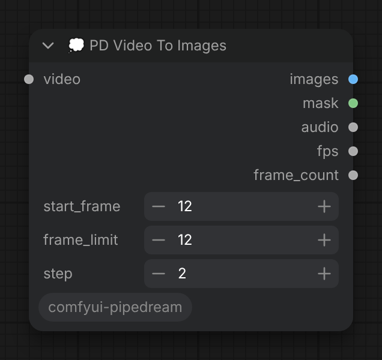
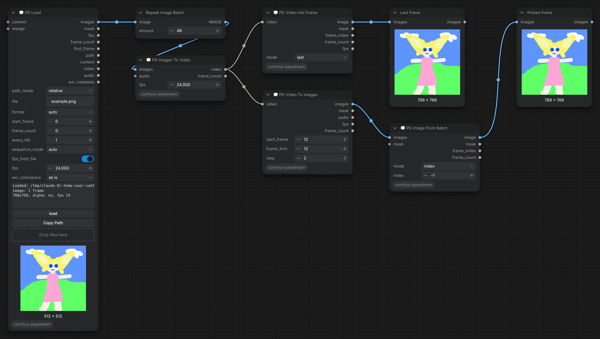

# PD Video To Images

Decodes a `VIDEO` into images, mask, audio and fps, and only the frame range you ask for. Use it instead of decoding a whole clip when you need a few frames.

## Typical use
1. Connect `video` (from PD Load, Load Video or PD Images To Video).
2. Set `start_frame`, `frame_limit` and `step` to pick the range.
3. Use `images`, `mask`, `audio` and `fps` downstream.

[03 Video frames](https://github.com/theonlyaaron/comfyui-pipedream/tree/main/workflows/03_video_frames) decodes 12 frames from frame 12, every 2nd.

## How it works
- Decodes `start_frame` to `start_frame + frame_limit x step`. `frame_limit` 0 means all remaining frames.
- `step` keeps every Nth frame; `fps` is the source rate divided by `step`, and the audio is trimmed to the decoded span.
- Output is float32 RGB 0 to 1. 10 and 12-bit sources keep their precision.
- `mask` is the alpha of the same frames (1.0 = opaque, straight): from ProRes 4444, `yuva*`, `rgba` and similar. It is full opacity when the video has none. In-memory videos use their own alpha or the fourth channel.
- `audio` is empty when the video has none. `frame_count` is the number of decoded frames.
- See [Alpha](https://github.com/theonlyaaron/comfyui-pipedream/blob/main/docs/alpha.md) for the mask convention.

## Tips
- Seeking assumes a constant frame rate.
- For a single frame, [PD Video Get Frame](https://github.com/theonlyaaron/comfyui-pipedream/blob/main/web/docs/PDVideoGetFrame.md) is cheaper.

## See also
- [PD Video Get Frame](https://github.com/theonlyaaron/comfyui-pipedream/blob/main/web/docs/PDVideoGetFrame.md), [PD Images To Video](https://github.com/theonlyaaron/comfyui-pipedream/blob/main/web/docs/PDImagesToVideo.md), [PD Image From Batch](https://github.com/theonlyaaron/comfyui-pipedream/blob/main/web/docs/PDImageFromBatch.md), [PD Load](https://github.com/theonlyaaron/comfyui-pipedream/blob/main/web/docs/PDLoad.md)
- [Alpha](https://github.com/theonlyaaron/comfyui-pipedream/blob/main/docs/alpha.md)

## Inputs and outputs
<!-- reference:start -->
<!-- Generated by tools/node_docs.py. Edit the node definition, not this block. -->

### Inputs

| Name | Type | Default | Required | Description |
|------|------|---------|----------|-------------|
| `video` | VIDEO |  | required |  |
| `start_frame` | INT | `0` | optional | First frame to decode (0-based). |
| `frame_limit` | INT | `0` | optional | Maximum number of frames to output. 0 = all remaining frames. |
| `step` | INT | `1` | optional | Keep every Nth frame. Output fps is divided by this value. |

### Outputs

| Name | Type | Description |
|------|------|-------------|
| `images` | IMAGE | Decoded frames, float32 RGB. |
| `mask` | MASK | Alpha of the same frames (1.0 = opaque, straight alpha). Full opacity when the video has no alpha. |
| `audio` | AUDIO | Audio cut to the decoded time span (None when the video has none). |
| `fps` | FLOAT | Source frame rate divided by step. |
| `frame_count` | INT | Number of decoded frames. |

This is not an output node: it runs only when another node needs its result.
<!-- reference:end -->
