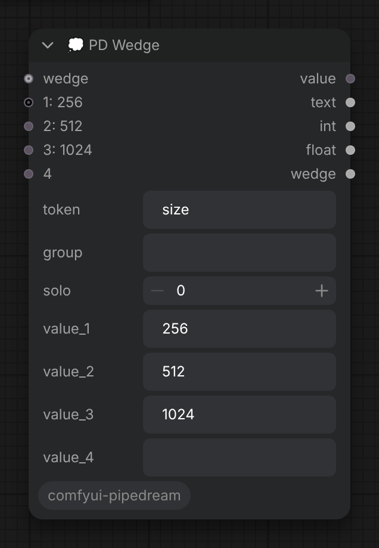
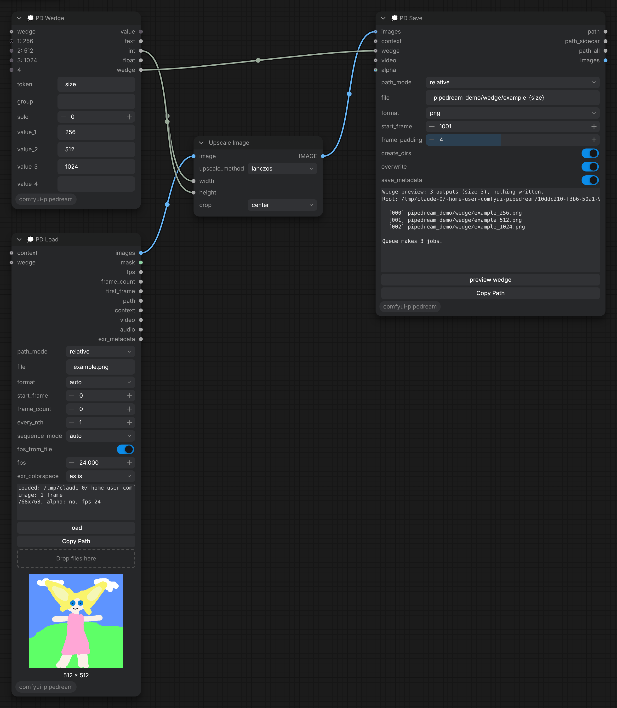

# PD Wedge

Runs the graph once per row of inputs. Each row pairs an input of any type (an image, a prompt, a model, a video) with a short text value, and one Run queues a job per row. Use it for comparison matrices, size or prompt tests and product variants.

## Typical use
1. Set `token` (for example `product`).
2. Link inputs to `input_1`, `input_2`... and name each row in `value_1`, `value_2`... Rows appear as you fill them.
3. Use `value` where the input would go. The row's text is also on `text`, `int` and `float`.
4. Connect `wedge` to PD Save's `wedge` input and use `{product}` or `{product_idx}` in the template.
5. Press **preview wedge** on PD Save to list every path, then Run.

[06 Wedge basics](https://github.com/theonlyaaron/comfyui-pipedream/tree/main/workflows/06_wedge_basics) needs no model. [07 Prompt wedge](https://github.com/theonlyaaron/comfyui-pipedream/tree/main/workflows/07_prompt_wedge) wedges three prompts. [08 Product matrix](https://github.com/theonlyaaron/comfyui-pipedream/tree/main/workflows/08_product_matrix) chains and groups wedges.

<!-- media: clip, 10 s: Run on a three-row wedge queueing three jobs -->

## How it works

### Rows
- Each row has an `input_n` (any type) and a `value_n` (text). Up to 16 rows; a spare row appears as you fill the last one.
- A row with only text outputs the text, so prompts, seeds and numbers can be typed in.
- `value` outputs the selected row's input, or its text when nothing is linked. `text` is the row's text; `int` and `float` convert it (2.7 gives 2; 0 when it is not a number).
- Only the selected row's input is computed. The rest of the graph is cached between jobs, and every job has the same seed.

### Tokens
- `token` names the wedge token in PD Save and PD Load: `product` gives `{product}` (the row's text) and `{product_idx}` (`000`, `001`...).
- PD Save also gets `{wedge_idx}` and `{wedge_total}`. Wedge tokens override context tokens of the same name.

### Chaining and groups
- Wedges chain through `wedge` and multiply: 3 products by 2 looks is 6 jobs. The first in the chain varies fastest.
- Wedges with the same `group` step together instead (a product image and its prompt) and need the same row count.
- `solo` runs one row number (0 means all), for a test render.
- Details: [Wedges](https://github.com/theonlyaaron/comfyui-pipedream/blob/main/docs/wedges.md).

### Checks
- Above 20 jobs, Run asks first.
- A wedge without rows, an empty solo row, or a mismatched group marks the wedge and queues nothing.
- The preview on PD Save warns about wedges not chained into it, paths written by several jobs, and existing files.

### Queuing
- The frontend expands the wedge when you queue: one prompt per job.
- A prompt posted to `/prompt` directly runs each wedge's first row only. See [Headless wedges](https://github.com/theonlyaaron/comfyui-pipedream/blob/main/docs/wedges-headless.md).

## Tips
- Wedge a prompt, not a seed, when you want to compare prompts fairly: the seed is shared across jobs.
- For long text in a row, use `{token_idx}` in the file template instead of the text.
- A wedge's branch is what [PD Profiler](https://github.com/theonlyaaron/comfyui-pipedream/blob/main/web/docs/PDProfiler.md) follows for the queued row, so it can report the job count before you run.

## See also
- [PD Save](https://github.com/theonlyaaron/comfyui-pipedream/blob/main/web/docs/PDSave.md), [PD Load](https://github.com/theonlyaaron/comfyui-pipedream/blob/main/web/docs/PDLoad.md), [PD Switch](https://github.com/theonlyaaron/comfyui-pipedream/blob/main/web/docs/PDSwitch.md), [PD Profiler](https://github.com/theonlyaaron/comfyui-pipedream/blob/main/web/docs/PDProfiler.md)
- Topic pages: [Wedges](https://github.com/theonlyaaron/comfyui-pipedream/blob/main/docs/wedges.md), [Headless wedges](https://github.com/theonlyaaron/comfyui-pipedream/blob/main/docs/wedges-headless.md), [Tokens](https://github.com/theonlyaaron/comfyui-pipedream/blob/main/docs/tokens.md)

## Inputs and outputs
<!-- reference:start -->
<!-- Generated by tools/node_docs.py. Edit the node definition, not this block. -->

### Inputs

| Name | Type | Default | Required | Description |
|------|------|---------|----------|-------------|
| `token` | STRING | `wedge` | required | Token name for PD Save, e.g. product gives {product} and {product_idx}. |
| `group` | STRING | `""` | optional | Wedges with the same group step together (row 1 with row 1...) instead of multiplying. Empty: multiply. |
| `solo` | INT | `0` | optional | Run only this row number, e.g. for a test render. 0: every row. |
| `wedge` | WEDGE |  | optional | Previous wedge in the chain. It varies faster than this one. |
| `input_1 … input_16` | any |  | optional | Anything: image, prompt, model, video... Only the selected row is computed. |
| `value_1 … value_16` | STRING | `""` | optional | Token value for row 1. With nothing linked to input_1, also the row's value. |

### Outputs

| Name | Type | Description |
|------|------|-------------|
| `value` | any | The selected row's input, or its text when nothing is linked. |
| `text` | STRING | The selected row's text (the token value). |
| `int` | INT | The selected row's text as an integer (2.7 gives 2; 0 if not a number). |
| `float` | FLOAT | The selected row's text as a float (0.0 if not a number). |
| `wedge` | WEDGE | This wedge and the wedges chained before it, for the next wedge or PD Save. |

This is not an output node: it runs only when another node needs its result.
<!-- reference:end -->
